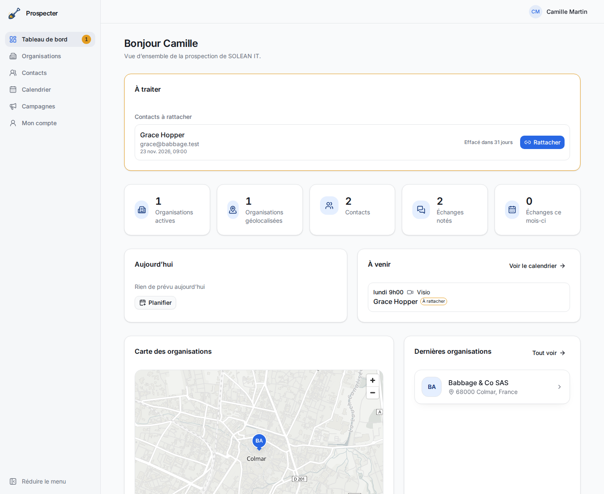
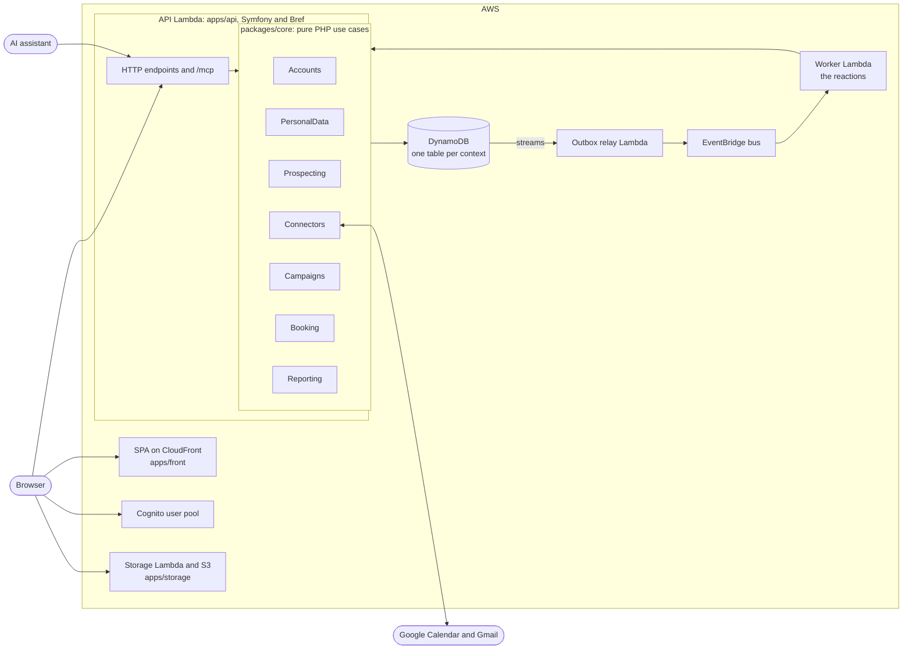

# Prospecter

Prospecter is a B2B prospecting application for small teams. An account's members share the organizations they prospect, their contacts and every exchange with them, and plan what comes next.

*A prospector's dashboard, on the demonstration data that `make install` creates. The interface is in French.*

## What it does

- **Organizations**: the companies an account prospects, shared by the whole team. Prospecter geocodes each one and places it on a map. It finds the organization's SIRET in the public directory of French companies. Two organizations that look alike are flagged as possible duplicates.
- **Contacts**: the people who work there. Their personal data live in a context of their own. That context decides who reads them unmasked. A member without the right to manage personal data sees their details masked.
- **Exchanges**: calls, e-mails, messages, meetings and video calls, gathered in each organization's timeline. A planned exchange appears in its holder's calendar, with the to-dos.
- **Connectors**: a member connects Google. Prospecter pushes their planned exchanges into Google Calendar and imports the e-mails Gmail exchanged with their contacts.
- **Campaigns**: tags on organizations and contacts, some derived automatically (location, how a contact is reached), to target the recipients of a campaign.
- **Booking**: each member's public booking page, which offers their free slots and turns a booked slot into a planned exchange.
- **Reporting**: each account's figures on its dashboard.
- **AI assistants**: an MCP server lets an AI act as its member, signed in like them.

## Architecture

- **Clean architecture.** The business rules live in `packages/core`, a pure PHP library with no framework. The API adapts it to HTTP, DynamoDB and Cognito; the front only presents.
- **Bounded contexts.** Prospecter has seven contexts. Each one has its own language and its own table. Most of them publish the questions the others ask. A context never reads another's tables. It asks the services the other context publishes, through an anticorruption layer. It also reacts to the other context's integration events.
- **Asynchronous reactions.** A command writes its aggregate and its events in one transaction (an outbox). A relay publishes the events on an EventBridge bus, and a worker runs each reaction in its own transaction.
- **Serverless.** The API and the storage run in Lambdas, locally too: MiniStack emulates the AWS services in Docker.

| Path | What |
|---|---|
| `packages/core/` | `prospecter/core`: the bounded contexts and their shared kernel, pure PHP, described by Gherkin scenarios |
| `apps/api/` | Symfony 8.1 JSON API (Bref Lambda), documented by OpenAPI, with DynamoDB, Cognito and the MCP server |
| `apps/storage/` | Symfony 8.1 app keeping uploaded files in S3 and serving images in named sizes |
| `apps/front/` | React 19 SPA: TypeScript, Vite, TanStack Router and Query, shadcn/ui and Tailwind CSS, MapLibre |
| `docker/` | The PHP 8.5, Node 24, nginx and Lambda images |

## Key decisions

Each decision has a record in [`docs/adr`](docs/adr/README.md). The ones that shape the rest:

- [0005](docs/adr/0005-clean-architecture-with-the-core-as-hexagon.md): clean architecture, the core is the hexagon, the API adapts, the front presents.
- [0017](docs/adr/0017-gherkin-acceptance-tests-on-the-core.md): Gherkin acceptance tests on the core, with only its ports doubled.
- [0029](docs/adr/0029-cqrs-with-a-synchronous-messenger-command-bus.md): CQRS, commands return nothing, only queries return data.
- [0031](docs/adr/0031-personal-data-context.md): a PersonalData context keeps the personal data of natural persons and decides who reads them.
- [0045](docs/adr/0045-published-language-between-contexts.md): each context publishes the questions the others ask, and its anticorruption layers see nothing else.
- [0048](docs/adr/0048-dynamodb-one-table-per-context-on-ministack.md): DynamoDB, one table per bounded context, emulated locally by MiniStack.
- [0055](docs/adr/0055-locally-the-apps-run-only-in-their-lambdas.md): locally, the API and the storage run only in their Bref Lambdas.
- [0098](docs/adr/0098-each-commit-writes-an-outbox-relayed-to-an-eventbridge-bus.md): each commit writes its events in an outbox, relayed to an EventBridge bus, and a worker runs the reactions.
- [0156](docs/adr/0156-an-mcp-server-without-session-in-the-lambda-of-the-api-its-callers-the-members-signed-in-on-cognito.md): an MCP server in the API's Lambda, its callers the members signed in on Cognito.
- [0090](docs/adr/0090-the-current-state-lives-in-documents-the-records-are-a-journal.md): the rules in force live in documents by subject; the records are an immutable journal.

The rules in force, by subject: [docs/README.md](docs/README.md). Instructions for AI coding assistants are in the `CLAUDE.md` files, which point to the same documents.

## Setup

Everything runs in Docker: you only need Docker (with the Compose plugin) and make on the host.

    make install
    make ca
    make start

- `make install` builds the images, installs the dependencies, and creates the tables, the user pool and the bucket in MiniStack, with the demonstration data and members.
- `make ca` creates, once per machine, the local authority that signs the local hosts' certificate. Import it once in your browser and no stack shows a certificate warning: see [Trusting the local authority](docs/architecture/local-stack.md#trusting-the-local-authority).
- The hosts are `.localhost` names, which Chrome, Firefox and curl resolve to the loopback themselves: nothing goes in `/etc/hosts`.

Then open:

- the application, https://prospecter.localhost, signed in as `prospector@solean-it.io` / `password` (or `assistant@solean-it.io`, who sees contacts' details masked);
- the API documentation, https://api.prospecter.localhost/api/doc.

Local overrides go in `apps/<app>/.env.local`. Addresses are geocoded by the French State's service (IGN Géoplateforme): free, no key, addresses in France only.

## Develop

`make` (or `make help`) lists every command; [commands.md](docs/architecture/commands.md) describes them.

| Command | Purpose |
|---|---|
| `make start` / `make stop` / `make logs` | Run the stack (the front reloads on save) |
| `make deploy` | Redeploy the API's and the storage's Lambdas (`make start` does it) |
| `make test` | The core's business rules (Behat) and unit tests, and the API, storage and front tests |
| `make test-core` / `make test-api` / `make test-storage` / `make test-front` | One of them |
| `make e2e` | The Playwright journeys, on the running stack |
| `make ci` | What the continuous integration runs: build, lint, tests, contract, front build |
| `make lint` / `make fix` | PHPStan, php-cs-fixer, Rector, Biome, TypeScript (and Terraform for `make lint`) |
| `make api-doc` | Regenerate the API's OpenAPI contract and the front's API types after an endpoint changes |
| `make db` | Reset the API's tables and user pool and the storage's bucket, with the demonstration data and members |
| `make infra-plan APP=api INSTANCE=dev` / `make infra-apply …` / `make infra-lint` | An app's Terraform on AWS ([infrastructure](docs/architecture/infra.md); its values are internal configuration) |
| `make package-<api\|storage\|front>` / `make release-front INSTANCE=dev` / `make console INSTANCE=dev CMD=…` | Package an app for AWS, upload the SPA's release, run an API command on an instance ([infrastructure](docs/architecture/infra.md)) |
| `make hooks` | Install the pre-commit hook that refuses secrets and AWS identifiers (`make install` does it) |
| `make commands` | List the core's commands and their handlers |
| `make exec-api` / `make exec-front` | A shell in the PHP or Node container |

## Contributing

Work starts from `dev` on a `feature/<name>` or `fix/<name>` branch and comes back by pull request, merged by rebase once the continuous integration (GitHub Actions, `make ci`) passes. `dev` goes to `main` by a pull request merged with a merge commit: a release. A `hotfix/<name>` branch starts from `main`, comes back the same way, then is cherry-picked onto `dev`. `main` and `dev` accept no direct push ([ADR 0057](docs/adr/0057-continuous-integration-around-dev.md), [0058](docs/adr/0058-main-receives-dev-and-hotfixes-by-merge-commits.md)).
