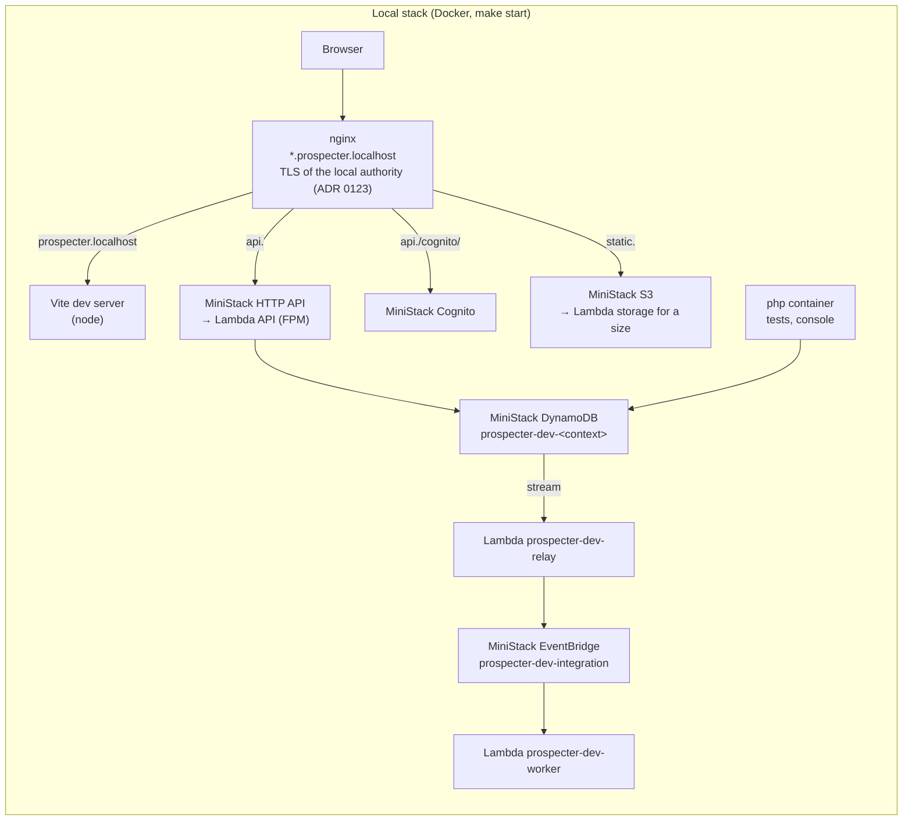
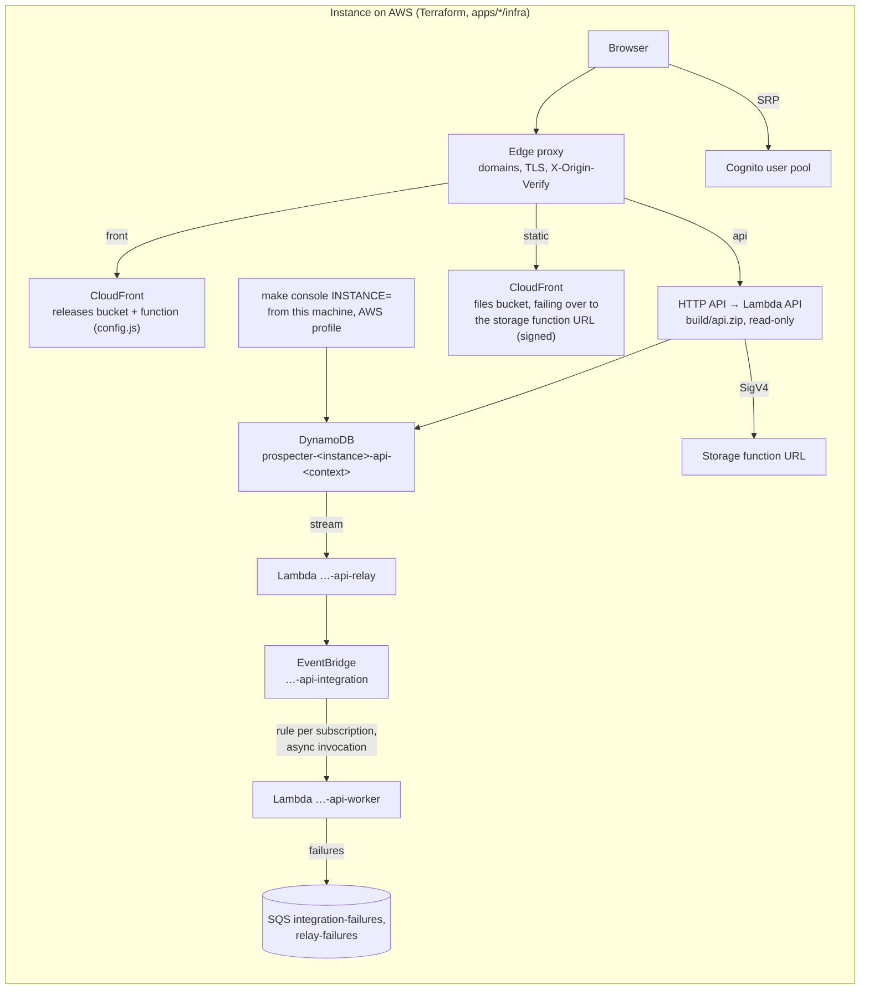

# The local stack and the instances on AWS

This document states the rules in force. The decision records (`docs/adr`) explain why: read them only for that, or before changing a rule (ADR 0090).

The same code runs in both: the API and the storage in Bref Lambdas, on DynamoDB, Cognito, S3, EventBridge and SQS. Locally, MiniStack emulates those services in Docker (ADR 0048, 0055). An instance (`dev`, `prod`) is the same Terraform applied with its installation's values (ADR 0059): `dev` on each merge into `dev`, `prod` on each merge into `main` after approval (ADR 0061, 0062). This document lists where they differ, and what only an instance on AWS proves. How each one runs: [local-stack.md](local-stack.md), [infra.md](infra.md); the messaging itself: [messaging.md](messaging.md).

## The two pictures

## Component by component

| | Local stack | Instance on AWS |
|---|---|---|
| Entry | nginx in Docker, on the hosts `prospecter.localhost`, `api.` and `static.prospecter.localhost`, which the browser resolves to the loopback (ADR 0126); a certificate signed by the machine's local authority (`make ca`, ADR 0123), or a self-signed one without it | an edge proxy on the instance's domains (ADR 0067); the AWS addresses refuse what lacks the edge's secret (`X-Origin-Verify`) |
| SPA | the Vite dev server, one request per module, hot reload | a release built once (`make package-front`), in a bucket behind CloudFront, its `config.js` returned by a CloudFront Function (ADR 0066) |
| API | a MiniStack Lambda with the repository mounted, the `dev` environment, the profiler, OPcache revalidating every 2 s, and a local `bootstrap` that makes up for MiniStack's gaps (ADR 0055, 0082) | `build/api.zip`, the `prod` environment, read-only (`BrefKernel`), its secrets read from SSM at startup (`bref-ssm:`) (ADR 0063) |
| CORS | MiniStack answers the preflights itself, from the CORS that `deploy.sh` sets on the HTTP API (keep it equal to `nelmio_cors`) | the HTTP API and `nelmio_cors`, with the front's address as the origin |
| Public booking pages | limited per link code by the api only (ADR 0153) | also capped by the HTTP API on their route, and per address by the installation's edge |
| Storage | nginx proxies MiniStack's bucket; the internal entry is `http://nginx:8080`, with a token only. The API sends the files the AIs attach, with an upload's form, to MiniStack itself, since the form names the static host (`PRIVATE_UPLOADS_ENDPOINT` `http://ministack:4566`, ADR 0172) | CloudFront on the bucket, failing over to a function URL that answers only requests signed by the API's role or by CloudFront (ADR 0065, 0068); removed files are invalidated (ADR 0070). The API sends the files the AIs attach to S3 at their form's address (`PRIVATE_UPLOADS_ENDPOINT` empty) |
| Cognito | MiniStack's, which the SPA reaches through `https://api.prospecter.localhost/cognito/`. It does not refuse a second holder of a login email (the API checks first). For the AIs (ADR 0157): its own sign-in form, reached through nginx (`/cognito/oauth2/authorize`, `/login`), the client `prospecter-mcp` created by `app:user-pool:recreate`, and the request-sealing key as an env value. On a global sign-out, it revokes only the tokens issued before that second | Cognito, which the SPA calls directly; a duplicate alias is also refused, as a safety net. For the AIs: the hosted UI on a pool domain, the client `prospecter-mcp` created by `cognito.tf`, and the request-sealing key as an SSM parameter (`bref-ssm:`) |
| DynamoDB | tables `prospecter-dev-<context>`, recreated by `make db` with the demo data; TTL applied within seconds | tables `prospecter-<instance>-api-<context>`, protected from deletion, recoverable to the second; TTL within days (AWS deletes expired items in the background) |
| Geocoder | the IGN, except for an nginx double while `make e2e` runs (ADR 0092) | the IGN |
| Company directory | the French State's service (Recherche d'entreprises); no journey searches it, so there is no nginx double (ADR 0158) | the French State's service |
| Google | an nginx double (`docker/nginx/conf.d/google-double.conf`, ADR 0120): its authorization page on the API's host, every code granting the account `agenda@solean-it.io` the requested scopes, its calendar accepting every push (ADR 0127). The demo account uses the double's client. To reach Google itself: Google's addresses in `apps/api/.env.local` and a real client configured by an administrator | accounts.google.com, oauth2.googleapis.com and www.googleapis.com (the calendar); each account's client configured by its administrator, its secret in SSM (ADR 0125) |
| Configuration | `apps/api/.env`, `apps/storage/.env` | Terraform variables and SSM parameters, the values out of the repository (`INFRA_CONFIG`) |
| Deployment | `make start`, `docker/lambda/deploy.sh` (AWS CLI against MiniStack, never Terraform) | Terraform in the CI: a plan on each pull request, an apply on `dev` at the merge, and on `prod` at the merge into `main` after approval |
| Schedule | none: MiniStack runs no schedule. `make console CMD="app:scheduled-tasks:run"` runs every scheduled task; `CMD="app:contacts:erase-unattached"` only erases the contacts left unattached (ADR 0147), and `CMD="app:gmail:renew-watches"` only renews the Gmail watches (ADR 0154) | EventBridge Scheduler calls `prospecter-<instance>-api-scheduled` once a day, which runs every task, `erase-unattached` and `renew-gmail-watches` (`infra/schedule.tf`, ADR 0161) |
| Gmail notifications | none: Google never pushes to the local stack, and the Google double watches a mailbox without ever notifying | the Pub/Sub of each account's Google Cloud pushes them to `/api/accounts/<account>/gmail-notifications` (ADR 0154) |
| Console | `make console CMD="…"`, the `php` container on MiniStack | `make console INSTANCE=<instance> CMD="…"`: the local code, on the instance's data, refused while it lags behind the instance (ADR 0107) |

## The messaging

MiniStack differs most in the asynchronous part (measured on MiniStack 1.5.27). The happy path is the same; the failure paths are proven only on AWS.

| | Local stack | Instance on AWS |
|---|---|---|
| Delivery | `outbox` (`apps/api/.env`); `sync` in the tests | `outbox`, the default of `integration_events_delivery` (ADR 0108) |
| Names | `prospecter-dev-relay`, `prospecter-dev-worker`, bus `prospecter-dev-integration`, queues `prospecter-dev-{relay,integration}-failures` and `prospecter-dev-worker-invocations` | `prospecter-<instance>-api-relay`, `…-api-worker`, `…-api-integration`, `…-api-{relay,integration}-failures` |
| Relay mappings | the streams of `accounts`, `connectors`, `personal-data` and `prospecting` | every table's stream, `reporting` included (it writes no outbox) |
| Relay's failing batch | MiniStack neither splits it nor stops after 5 attempts: it retries about once a second until the batch is **60 s** old, then sends its metadata to `relay-failures` | split until the failing record is alone, 5 retries, a record **a day** old at most, then `relay-failures` (`RetryAttemptsExhausted`) |
| Rule → worker | the same input transformer puts the invocation in the queue `prospecter-dev-worker-invocations`, whose mapping hands it to the worker, 10 at once at most (ADR 0131). A failure is received again after 30 s, then kept in `integration-failures` at its third receive (`RetriesExhausted`). `aws_lambda_permission` is not checked; the target's `retry_policy` and DLQ are ignored | an asynchronous invocation: 2 retries, 6 hours at most, then `integration-failures`. A rule that cannot invoke retries for a day (185 attempts), then the same queue. One permission per rule |
| Refused by the worker | the worker itself puts it in `integration-failures`: the same on both | the same |
| Worker invoked directly (`app:integration:redrive`, `--invocation-type Event`) | retries and destination applied, like AWS | the same |
| Cold start | about 16 s for a container's first call; `make e2e` first warms the relay and as many workers as their concurrency (`deploy.sh warm`). A gesture with many reactions starts many containers, hence `MINISTACK_DOCKER_TIMEOUT` 120 s | about 0.5 s for the relay, 0.8 s for the worker; about 3 s from the API's answer to a reaction when cold, 0.7 s when warm (dev, 2026-11-12) |
| Concurrency | MiniStack starts containers through the Docker socket. The worker runs 10 at once (`WORKER_CONCURRENCY`). The rules put its invocations in a queue whose mapping hands them over as the worker has room, since MiniStack loses a rule's invocation that the reserved concurrency refuses (ADR 0131) | the account's concurrency, shared with the API. The worker is unreserved unless the instance sets `worker_concurrency` (ADR 0132); then it is reserved, and Lambda keeps and retries an invocation beyond it |
| Logs | `apps/api/var/log/dev.log`, with the correlation on each line, every level | CloudWatch, one log group per function: the `mailbox` channel (the e-mail import) and the `messaging` channel (the relay and the worker) at info; every channel before an error too (`fingers_crossed`, written with the lines kept before it); no personal data at info (ADR 0167) |
| Failure queues | emptied by `make db` (`deploy.sh purge`), since their messages are about the data it destroys | kept 14 days; no command empties them except `app:integration:redrive` |
| Failure queue alarms | none: MiniStack (1.5.27) evaluates an alarm only when metrics are put, its SQS publishes none, and its e-mail subscriptions only log. `app:consistency:check` lists what the queues hold | one alarm per queue: a message visible within 5 minutes e-mails the instance's addresses (`alert_emails`), and so does its end (ADR 0178) |
| Function and 5xx alarms | none, for the same reasons: the functions' logs and `make e2e` show a failure | one alarm per function on its errors and on its throttles, one on a failing scheduled task, one on the 5xx of the api's HTTP API and of the storage's function URL, all e-mailing the same addresses (ADR 0179) |
| A new subscription | `make db`, or `deploy.sh relay`, reads `subscriptions.json` with `jq` | a rule, a target and a permission at the next apply (`jsondecode` of the same file) |

What only an instance proves, and what going live checked on `dev`: a rule invoking the worker under its permission, the retries and the destination of an invocation coming from a rule, the `relay-failures` queue reached after 5 retries, and the input transformer in a failure's `requestPayload`. The split of a multi-record batch has not been seen at work.

## The same everywhere

- The code: it never branches on the environment, except through what the configuration names (MiniStack's endpoints, the storage's authentication, the `dev` profiler).
- The tables, their keys and indexes (`Shared\Persistence\Tables` locally, `tables.tf` on AWS, kept in sync), the `NEW_IMAGE` streams, the TTL on `expiresAt`.
- The subscriptions, from a single file, `apps/api/config/subscriptions.json`.
- The function sizes: 1024 MB for the API and the worker, 512 MB for the relay; a 28 s timeout each, except the worker's 120 s (ADR 0182).
- The console commands: the same code, locally or with `INSTANCE=`.

## Why a local stack so close to AWS

The API and the storage run only in their Lambdas, locally too (ADR 0055): what fails because of Lambda (a read-only file system, a response's size, a cold start, an asynchronous invocation) fails on the developer's machine first. MiniStack costs nothing and needs no AWS account. Its gaps are known and listed above. The API's tests cover the paths it does not emulate, with doubles of the AWS clients (`OutboxRelayTest`, `IntegrationEventConsumerTest`), and those paths were then checked once on `dev`.
