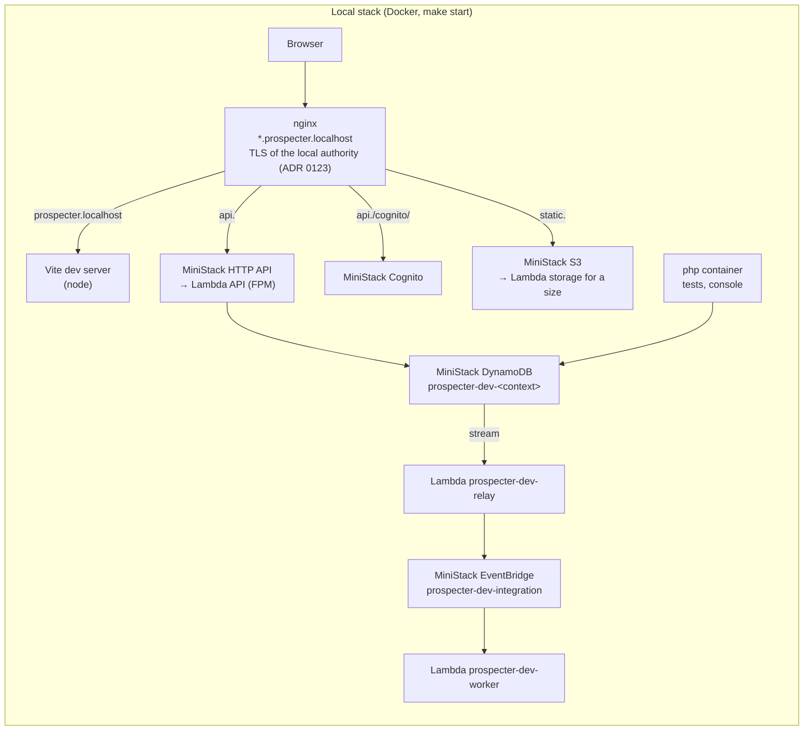
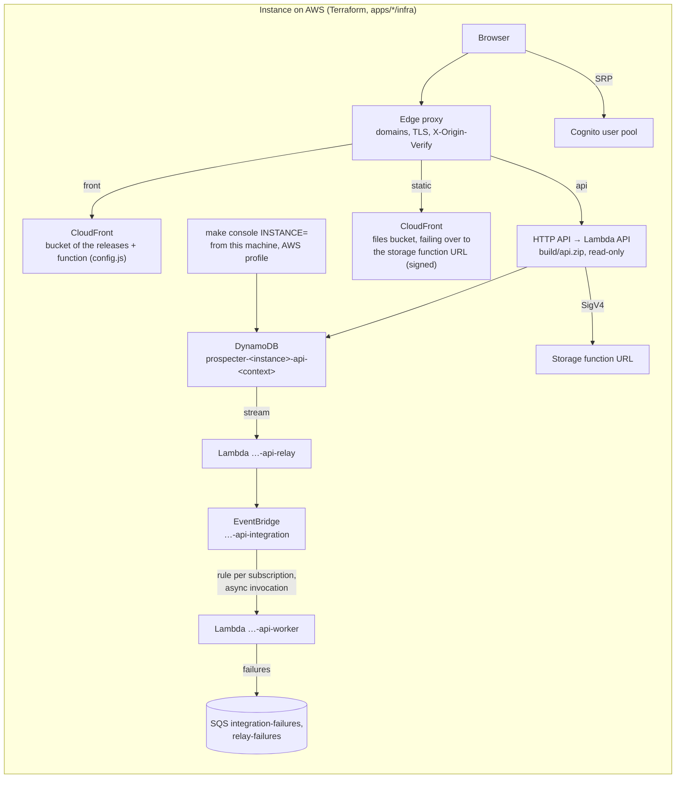

# The local stack and the instances on AWS

What is in force; the reasons are in the records it names (`docs/adr`), read only to know why or before changing it (ADR 0090).

The same code runs in both: the API and the storage in Bref Lambdas, on DynamoDB, Cognito, S3, EventBridge and SQS. Locally MiniStack emulates those services in Docker (ADR 0048, 0055); an instance (`dev`, `prod`) is the same Terraform applied with the values of its installation (ADR 0059), `dev` at each merge on `dev`, `prod` at each merge on `main` after approval (ADR 0061, 0062). This document lists where they differ, and what only an instance on AWS proves. How each runs: [local-stack.md](local-stack.md), [infra.md](infra.md); the messaging itself: [messaging.md](messaging.md).

## The two pictures

## Component by component

| | Local stack | Instance on AWS |
|---|---|---|
| Entry | nginx in Docker, the hosts `prospecter.localhost`, `api.` and `static.prospecter.localhost`, which the browser resolves to the loopback (ADR 0126), the certificate the local authority of the machine signed (`make ca`, ADR 0123), a self-signed one without it | an edge proxy on the domains of the instance (ADR 0067), the AWS addresses refusing what lacks its secret (`X-Origin-Verify`) |
| SPA | the dev server of Vite, a request per module, hot reload | a release built once (`make package-front`), in a bucket behind CloudFront, its `config.js` answered by a CloudFront Function (ADR 0066) |
| API | a Lambda of MiniStack, the repository mounted, the `dev` environment, the profiler, OPcache revalidating every 2 s, a local `bootstrap` making up for MiniStack (ADR 0055, 0082) | `build/api.zip`, the `prod` environment, read-only (`BrefKernel`), its secrets read from SSM at the start (`bref-ssm:`) (ADR 0063) |
| CORS | MiniStack answers the preflights itself, from the CORS `deploy.sh` gives the HTTP API (to keep equal to `nelmio_cors`) | the HTTP API and `nelmio_cors`, the origin the address of the front |
| Public booking pages | limited by the code of their link by the api only (ADR 0153) | also capped by the HTTP API on their route, and by address at the edge of the installation |
| Storage | nginx proxies the bucket of MiniStack, the internal entry `http://nginx:8080` with a token only | CloudFront on the bucket, failing over to a function URL that answers only requests signed by the role of the API or by CloudFront (ADR 0065, 0068), removed files invalidated (ADR 0070) |
| Cognito | MiniStack, reached by the SPA through `https://api.prospecter.localhost/cognito/`; it does not refuse a second holder of a login email (the API checks it first); for the AIs (ADR 0157), its own sign-in form reached through nginx (`/cognito/oauth2/authorize`, `/login`), the client `prospecter-mcp` made by `app:user-pool:recreate`, the key sealing the requests an env value; it revokes on a global sign-out only the tokens issued before its second | Cognito, the SPA calling it directly; a duplicate alias refused as a safety net too; for the AIs, the hosted UI on a domain of the pool and the client `prospecter-mcp` made by `cognito.tf`, the key sealing the requests a parameter of SSM (`bref-ssm:`) |
| DynamoDB | tables `prospecter-dev-<context>`, recreated by `make db` with the demonstration; TTL applied within seconds | tables `prospecter-<instance>-api-<context>`, protected from deletion, recoverable to the second; TTL within days (AWS deletes expired items in the background) |
| Geocoder | the IGN, but a double of nginx while `make e2e` runs (ADR 0092) | the IGN |
| Directory of the companies | the service of the French State (Recherche d'entreprises), no journey searching it: no double of nginx (ADR 0158) | the service of the French State |
| Google | a double of nginx (`docker/nginx/conf.d/google-double.conf`, ADR 0120): its authorization page on the host of the API, every code granting the account `agenda@solean-it.io` the scopes asked, its calendar taking every push (ADR 0127); the account of the demonstration served by the client of the double; the addresses of Google in `apps/api/.env.local` and a real client configured by an administrator to reach Google itself | accounts.google.com, oauth2.googleapis.com and www.googleapis.com (the calendar), the client of each account configured by its administrator, its secret in SSM (ADR 0125) |
| Configuration | `apps/api/.env`, `apps/storage/.env` | Terraform variables and SSM parameters, the values out of the repository (`INFRA_CONFIG`) |
| Deployment | `make start`, `docker/lambda/deploy.sh` (AWS CLI against MiniStack, never Terraform) | Terraform by the CI: plan on each pull request, apply on `dev` at the merge, on `prod` at the merge on `main` after approval |
| Schedule | none: MiniStack runs no schedule, every scheduled task run by `make console CMD="app:scheduled-tasks:run"`, the contacts left unattached erased alone by `CMD="app:contacts:erase-unattached"` (ADR 0147), the watches of Gmail renewed alone by `CMD="app:gmail:renew-watches"` (ADR 0154) | EventBridge Scheduler calls `prospecter-<instance>-api-scheduled` once a day, which runs every task, `erase-unattached` and `renew-gmail-watches` (`infra/schedule.tf`, ADR 0161) |
| Notifications of Gmail | none: no Google pushes to the local stack, the double of Google watching a mailbox without ever notifying it | Pub/Sub of the Google Cloud of each account pushes them to `/api/accounts/<account>/gmail-notifications` (ADR 0154) |
| Console | `make console CMD="…"`, the `php` container on MiniStack | `make console INSTANCE=<instance> CMD="…"`: the local code, on the data of the instance, refused while it lags behind it (ADR 0107) |

## The messaging

The asynchronous part is where MiniStack differs most (measured on MiniStack 1.5.27). The happy path is the same; the paths of failure are only proven on AWS.

| | Local stack | Instance on AWS |
|---|---|---|
| Delivery | `outbox` (`apps/api/.env`); the tests `sync` | `outbox`, the default of `integration_events_delivery` (ADR 0108) |
| Names | `prospecter-dev-relay`, `prospecter-dev-worker`, bus `prospecter-dev-integration`, queues `prospecter-dev-{relay,integration}-failures` and `prospecter-dev-worker-invocations` | `prospecter-<instance>-api-relay`, `…-api-worker`, `…-api-integration`, `…-api-{relay,integration}-failures` |
| Relay mappings | the streams of `accounts`, `connectors`, `personal-data` and `prospecting` | the stream of every table, `reporting` included (it writes no outbox) |
| Failing batch of the relay | neither split nor stopped after 5 attempts by MiniStack: retried about once a second until it is **60 s** old, then its metadata to `relay-failures` | split until the failing record is alone, 5 retries, a record **a day** old at most, then `relay-failures` (`RetryAttemptsExhausted`) |
| Rule → worker | the invocation put, by the same input transformer, in the queue `prospecter-dev-worker-invocations`, whose mapping gives it to the worker 10 at once at most (ADR 0131): a failure received again after 30 s, then, at its third receive, kept in `integration-failures` (`RetriesExhausted`); `aws_lambda_permission` not checked; `retry_policy` and the DLQ of the target ignored | an asynchronous invocation: 2 retries, 6 hours at most, then `integration-failures`; a rule unable to invoke retries a day (185 attempts), then the same queue; one permission per rule |
| Refused by the worker | put in `integration-failures` by the worker itself: the same on both | the same |
| Worker invoked directly (`app:integration:redrive`, `--invocation-type Event`) | retries and destination applied, like AWS | the same |
| Cold start | some 16 s for the first call of a container; `make e2e` warms the relay and as many workers as their concurrency first (`deploy.sh warm`); a gesture of many reactions starts many containers, hence `MINISTACK_DOCKER_TIMEOUT` 120 s | about 0.5 s for the relay, 0.8 s for the worker; about 3 s from the answer of the API to a reaction cold, 0.7 s warm (dev, 2026-11-12) |
| Concurrency | containers started by MiniStack through the Docker socket; the worker 10 at once (`WORKER_CONCURRENCY`), the rules putting its invocations in a queue whose mapping gives them to it as it has room, MiniStack losing an invocation of a rule its reserved concurrency refuses (ADR 0131) | the concurrency of the account, shared with the API; the worker unreserved unless the instance sets `worker_concurrency` (ADR 0132), then reserved, Lambda keeping and retrying an invocation beyond it |
| Logs | `apps/api/var/log/dev.log`, the correlation in each line | CloudWatch, a log group per function |
| Queues of the failures | emptied by `make db` (`deploy.sh purge`), their messages being about the data it destroys | kept 14 days, never emptied by a command but `app:integration:redrive` |
| A new subscription | `make db`, or `deploy.sh relay`, reads `subscriptions.json` with `jq` | a rule, a target and a permission at the next apply (`jsondecode` of the same file) |

What only an instance proves, and what its putting in service checked on `dev`: a rule invoking the worker under its permission, the retries and the destination of an invocation coming from a rule, the queue `relay-failures` reached after 5 retries, the input transformer in the `requestPayload` of a failure. The split of a batch of several records was not seen at work.

## The same everywhere

- The code: no branch of the code on the environment but what the configuration names (the endpoints of MiniStack, the authentication of the storage, the profiler of `dev`).
- The tables, their keys and indexes (`Shared\Persistence\Tables` locally, `tables.tf` on AWS, kept alike), the streams `NEW_IMAGE`, the TTL on `expiresAt`.
- The subscriptions, from one file, `apps/api/config/subscriptions.json`.
- The sizes of the functions: the API and the worker 1024 MB, the relay 512 MB, 28 s each.
- The commands of the console: the same code, locally or with `INSTANCE=`.

## Why a local stack so close to AWS

The API and the storage run only in their Lambdas, locally too (ADR 0055): what fails because of Lambda (a read-only file system, the size of a response, a cold start, an asynchronous invocation) fails on the developer's machine first. MiniStack costs nothing and needs no AWS account; its gaps are known and listed above, and the paths it does not emulate are covered by the tests of the API with doubles of the AWS clients (`OutboxRelayTest`, `IntegrationEventConsumerTest`), then checked once on `dev`.
