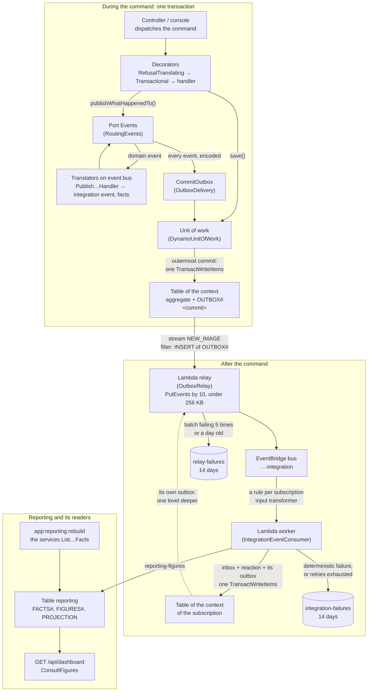
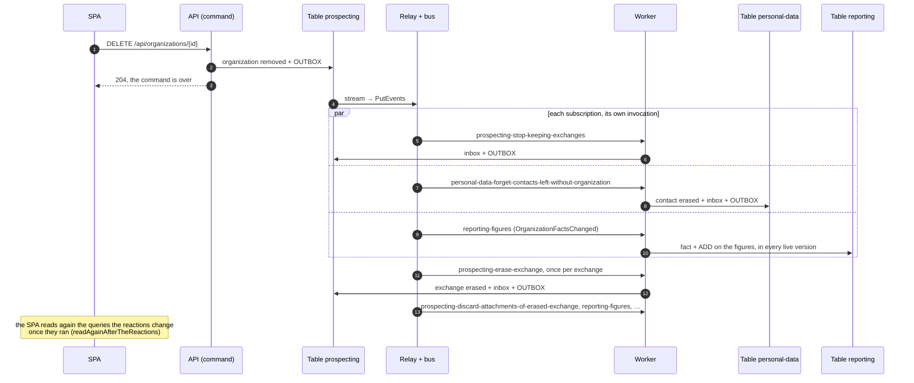
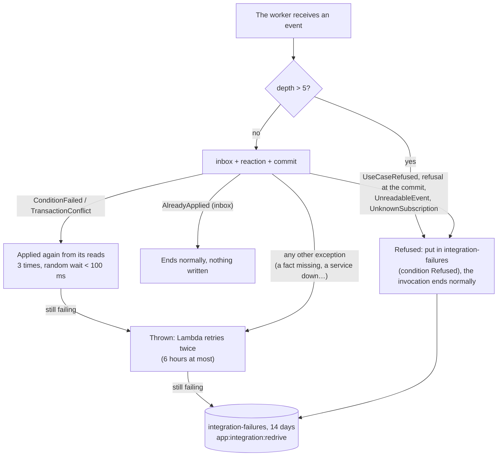

# Messaging between the contexts

This document states the rules in force. The decision records (`docs/adr`) explain why: read them only for that, or before changing a rule (ADR 0090).

This document describes how a member's gesture reaches the other aggregates and the other contexts. Each command runs in one transaction and writes its events with it in an outbox. The outbox is relayed to an EventBridge bus, which hands the events to a worker. The worker runs each reaction in its own transaction. This document gives the whole picture. The detailed rules live with their subjects:

- the event format, the subscriptions and the worker: [contexts.md](contexts.md);
- the unit of work, the outbox, the inbox and the Reporting table: [persistence.md](persistence.md);
- the API wiring: [api.md](api.md);
- the AWS resources: [infra.md](infra.md);
- the local emulation: [local-stack.md](local-stack.md) and [local-vs-aws.md](local-vs-aws.md).

## In short

1. **One transaction per command.** A command writes its aggregate and its events' outbox in one `TransactWriteItems`, or writes nothing (ADR 0095, 0098).
2. **Every reaction runs after the command.** It runs in the worker, in its own transaction, whether it stays inside a context or goes between contexts. The command answers as soon as its own transaction is written, and never knows who reacts (ADR 0101).
3. **Nothing is lost once written.** The stream, the relay, EventBridge and Lambda retry a bounded number of times. Whatever keeps failing waits in a failure queue for 14 days; nothing is dropped (ADR 0098, 0101).
4. **At least once, in no order.** Each reaction is idempotent: through its subscription's inbox, through a fact's revision for Reporting, or through the state it reads again (ADR 0102, 0099).
5. **A domain event never leaves its context.** It travels under a `.internal` source that only its context's subscriptions listen to. The other contexts get integration events, plain data from a `Contract` (ADR 0046, 0097).
6. **No loops.** Each event carries its depth. Beyond 5, it is refused (ADR 0097).
7. **The figures are rebuilt from the state, never from stored events.** There is no event store and no archive: an event lives a week in its outbox and 14 days in a failure queue (ADR 0096, 0103).
8. **Nothing is billed while nothing happens.** There is no poller and no service billed by the hour. Lambda reads the streams, EventBridge pushes, the failure queues have no consumers, and TTL deletes the items (ADR 0098).

## The picture



During the command, nothing is written before the commit: the aggregate and the outbox are written together, or not at all. The translators are the only handlers that run within the command. They turn a domain event into what the other contexts may know (an integration event, an aggregate's facts), so that it is written in the same outbox. Everything else is asynchronous.

## A gesture, step by step

The platform's longest chain follows when a member stops prospecting an organization that has one contact and two exchanges:



Each exchange is erased by its own reaction, so a gesture never exceeds a transaction's 100 writes, whatever the number of exchanges (ADR 0095). On AWS, a warm chain takes about 0.7 s from the API's answer to the written reaction, and about 3 s when the relay and the worker start cold (measured on dev, 2026-11-12).

## Vocabulary

| Term | Meaning |
|---|---|
| Unit of work | What a command or a reaction writes, kept in memory and sent in one `TransactWriteItems` (100 writes at most) at the outermost commit. It is the core's `UnitOfWork` port, implemented by `DynamoUnitOfWork` in the API. |
| Domain event | What happened to an aggregate, in its context's words (`ProspectingStopped`), identities only. It lives in its context's `Domain/Event`, never outside it. |
| Integration event | What a context promises the others (`ContactCollected`), plain data from its `Contract/Event`. |
| Facts | An integration event carrying an aggregate's snapshot and its revision rather than an intent (`OrganizationFactsChanged`). A **terminal** fact (absent, revision 0) ends the aggregate (ADR 0099). |
| Revision | A counter the repository increments at each `save()`, unknown to the aggregate. The latest snapshot has the highest. A save or a removal holds to the revision its unit of work read: an optimistic lock (ADR 0181, [persistence.md](persistence.md)). |
| Translator | A `Publish…Handler`. On the synchronous `event.bus`, within the command, it turns a domain event into an integration event or facts. |
| Reaction | Any other `EventHandler`. It runs in the worker, after the command, reached through a subscription. |
| Subscription | An entry in `apps/api/config/subscriptions.json`, named `<context>-<intent>`. It lists its sources, its events, its reaction(s) and its inbox. On AWS, it is a bus rule. |
| Outbox | The `OUTBOX#<commit>` item in the emitting context's table, one per commit, holding all its events. The table deletes it a week later (TTL). |
| Relay | The function that reads the tables' streams and publishes the outboxes on the bus. |
| Worker | The function that runs the reactions, one invocation per event and subscription. |
| Inbox | The `INBOX#<subscription>` / `<eventId>` item, written with the reaction's effects: an event is applied once per subscription. |
| Delivery | `INTEGRATION_EVENTS_DELIVERY`: `outbox` (local stack, instances) or `sync` (tests). |
| Correlation, cause, depth | In each event's envelope: the command it comes from, the event it reacts to, and how many reactions away from the command it is. |

## The envelope

Every event, domain or integration, travels as an EventBridge event:

```json
{
  "source": "prospecter.personal-data",
  "detail-type": "ContactCollected.v1",
  "detail": {
    "eventId": "0196…",
    "occurredAt": "2026-11-12T16:43:54.700000Z",
    "correlationId": "0196…",
    "causationId": null,
    "depth": 0,
    "payload": { "personId": "…", "accountId": "…", "organizationIds": ["…"] }
  }
}
```

- `source`: `prospecter.<context>` for an integration event, `prospecter.<context>.internal` for a domain event. It tells apart a domain event and an integration event with the same name (`AccountOpened`).
- `detail-type`: the class's short name, in English and in the past tense (ADR 0190), and its contract version. A payload change bumps the version once an outbox or a failure queue may hold the former shape. On the instances, that is now always the case. `ExchangeFactsChanged.v2` carries the exchange's status. `.v3` carries its contact and its campaign (ADR 0145). `.v4` carries whether an erased exchange went with its organization (ADR 0155). `.v1` to `.v3` are still read (`FORMER_TYPES`).
- One `EventCodec` encodes both kinds, with the classes listed in `DomainEventTypes` and `IntegrationEventTypes`. `EventCodecTest` fails for a class missing from them.

## The subscriptions

| Subscription | Listens to | Inbox | Effect |
|---|---|---|---|
| `accounts-register-the-founder` | `AccountOpened` (.internal) | yes | the founder becomes a member |
| `personal-data-collect-founder-profile` | `AccountOpened` | yes | the founder's empty profile |
| `personal-data-collect-member-profile` | `MemberRegistered` | yes | a member's empty profile |
| `personal-data-forget-contacts-left-without-organization` | `ContactsLeftWithoutOrganization` | yes | a contact no organization names is erased |
| `prospecting-attach-collected-contact` | `ContactCollected` | yes | the contact is attached to its organizations |
| `prospecting-detach-forgotten-contact` | `ContactForgotten` | yes | the contact is detached from its organizations |
| `prospecting-keep-exchanges-of-forgotten-contact` | `ContactForgotten` | yes | its exchanges are kept, to be redacted |
| `prospecting-forget-fingerprints-of-forgotten-contact` | `ContactForgotten` | yes | its exchanges' fingerprints are forgotten (ADR 0166) |
| `personal-data-identify-booker` | `SlotBooked` (Booking) | yes | the booker is identified: a contact found by their e-mail or their phone, or a new contact to attach, collected for the host (ADR 0164) |
| `prospecting-plan-booked-appointment` | `BookerIdentified` (PersonalData) | yes | the host's exchange with the booker is planned. The booker met is to be attached when nobody holds them, or handed over to the host when another member does (ADR 0164) |
| `prospecting-keep-created-video-call-link` | `VideoCallLinkCreated` (Connectors) | yes | the link Google created is kept on the video call still asking for one, which is pushed again (ADR 0137) |
| `prospecting-stop-keeping-exchanges` | `ProspectingStopped` (.internal) | yes | one `ExchangeLeftWithoutOrganization` per exchange |
| `prospecting-erase-exchange` | `ExchangeLeftWithoutOrganization` (.internal) | yes | the exchange is erased |
| `prospecting-discard-removed-logo` | `LogoRemoved` (.internal) | no | the file leaves the storage |
| `prospecting-keep-imported-attachment` | `AttachmentImported` (.internal) | no | the upload of an imported e-mail's file is kept once its exchange is written. An upload already kept needs nothing (ADR 0182) |
| `prospecting-discard-removed-attachment` | `AttachmentRemoved` (.internal) | no | the file leaves the storage |
| `prospecting-discard-attachments-of-erased-exchange` | `ExchangeErased` (.internal, .v1, .v2, .v3) | no | its files leave the storage |
| `reporting-figures` | `OrganizationFactsChanged`, `ExchangeFactsChanged`, `ContactFactsChanged` | no | Reporting's facts and figures, one reaction per detail-type |
| `connectors-unname-forgotten-contact` | `ContactForgotten` | yes | the events of the exchanges done or missed with the contact are pushed again without their name (ADR 0127) |
| `connectors-push-upcoming-exchanges` | `Connected`, `CalendarRecreated` (.internal) | yes | the exchanges the member still has planned are pushed into their « Prospecter » calendar at Google, the 40 soonest (ADR 0133) |
| `campaigns-forget-tags-of-unprospected-organization` | `OrganizationFactsChanged`, terminal ones only (`payload`) | no | the tags of an organization no longer prospected are forgotten (ADR 0138) |
| `campaigns-forget-tags-of-forgotten-contact` | `ContactForgotten` | no | the forgotten contact's tags are forgotten (ADR 0138) |
| `campaigns-forget-recipient-of-forgotten-contact` | `ContactForgotten` | no | the forgotten contact leaves the recipients of the frozen campaigns that keep it. A started campaign keeps it as an erased recipient, without its name |
| `campaigns-process-recipient` | `ExchangeFactsChanged` (.v3, .v4), only for an exchange that is present, done or missed (`payload`) | no | the recipient of the campaign the exchange was logged in is processed, done or missed. The campaign ends once nobody is left to handle. Nothing happens for an exchange outside any campaign, or for a recipient already handled (ADR 0145) |
| `campaigns-reopen-recipient` | `ExchangeFactsChanged` (.v3, .v4), only for an absent exchange (`payload`) | no | the recipient processed by the exchange a member erased is to be handled again. An ended campaign starts again, and a stopped one stays stopped. Nothing happens for an exchange outside any campaign, an erased campaign, a recipient processed by another exchange (ADR 0152), or an exchange gone with its organization (ADR 0155) |
| `booking-forget-appointment-of-erased-exchange` | `ExchangeFactsChanged` (.v4), only for an absent exchange (`payload`) | no | the appointment the exchange was booked as is forgotten: its slot is free again and its booker has no upcoming appointment. Nothing happens for an exchange that did not come from a booking (ADR 0171) |
| `campaigns-record-facts` | `OrganizationFactsChanged` (.v2, .v3), `ContactFactsChanged` (.v2) | no | the facts the contacts' tags derive from, one reaction per detail-type: the contacts an organization names, how a contact can be reached (ADR 0141) |
| `connectors-push-exchange` | `ExchangeFactsChanged` (.v2, .v3, .v4), only for an exchange that is planned, cancelled or erased (`payload`) | yes | the exchange is read again from Prospecting, then pushed into or withdrawn from its holder's « Prospecter » calendar at Google (ADR 0127) |

A subscription goes without an inbox when applying its event twice changes nothing: a file removed again is absent, a fact with a known revision is ignored, a tagging forgotten again is not there. Two subscriptions to one event are two rules, two invocations and two inboxes: one never replays or hides the other. `ReactionsAreSubscribedTest` keeps the list and the code in step: every reaction is subscribed, every subscription names a known reaction and events its sources publish, and only its own context listens to a `.internal` source.

## When something fails



- **Deterministic failures are not retried**: another attempt would repeat them. They wait for a deployed fix, then `app:integration:redrive`.
- **When in doubt, a failure is retried**: a reaction missing an earlier fact (the order is not guaranteed) throws and comes back later.
- **A reaction with nothing left to do ends without throwing**: an exchange already erased, an organization gone.
- **The relay** fails a whole batch when `PutEvents` refuses an entry. The mapping splits the batch, tries 5 times, keeps a record for a day at most, then sends the batch's metadata (not the events) to `relay-failures`. `app:outbox:republish --since=<moment>` publishes again the outboxes the tables still keep (a week).
- **A rule that cannot invoke the worker** (permissions, throttling) retries for a day, then puts the event in `integration-failures` too. Lambda keeps an invocation beyond the worker's reserved concurrency and retries it within an event's 6 hours (ADR 0131). Locally, the rules' invocations wait in a queue until the worker has room ([local-stack.md](local-stack.md)).
- On AWS, an alarm watches each failure queue (ADR 0178). When a message is visible there within 5 minutes, the alarm e-mails the instance's addresses (`alert_emails`). The alarm's description holds the recovery command. When the queue becomes empty again, the alarm e-mails them too. `app:consistency:check` measures the gap (below). Locally there is no alarm: MiniStack does not evaluate alarms ([local-vs-aws.md](local-vs-aws.md)).

## Sync and outbox

| | `sync` | `outbox` |
|---|---|---|
| Where | the core's scenarios, the API's tests (`.env.test`), an instance that sets it in its values | the local stack (`apps/api/.env`), the instances by default (ADR 0108), the worker always |
| Reactions | called at once, encoded and decoded through JSON, within the command's unit of work | in the worker, after the commit, each in its own unit |
| A refusing reaction | refuses the gesture, nothing written | the gesture succeeds; the event ends up in `integration-failures` |
| Inbox | none | per subscription |
| Limit | a gesture with many reactions may exceed 100 writes (stopping an organization with some thirty exchanges) | each reaction has its own 100 |
| Delay | none: what the answer shows is complete | about a second |

The core's scenarios reproduce the asynchronous order without a bus. `SynchronousEvents` delivers to the translators within the command, then to each reaction in its own unit once the command succeeded. A failure is kept (`failuresOf()`) rather than refusing the gesture (ADR 0101, [tests.md](tests.md)). The API's tests keep `sync`, so that a figure or an attachment is right as soon as the response arrives. Only the local stack, `make e2e` and the instances see eventual consistency.

## What members see

- **A command is not slower**: it stops at its commit, and no reaction runs in the request.
- **What follows from a gesture arrives about a second later**: a collected contact appears on its organization, the exchanges of an organization no longer prospected disappear, a dashboard figure moves. The SPA reads again the queries a gesture's reactions change, at once and once they ran (`readAgainAfterTheReactions`, `shared/api/reactions.ts`, [front.md](front.md)). The e2e journeys rely on Playwright's retried assertions, never on a fixed pause.
- **A member who signs in right after their registration** may find their profile not yet collected. The SPA shows « Votre profil est en cours de préparation… », reads it again with a growing delay, and after a minute shows « Réessayez plus tard »; then « Complétez votre profil » (ADR 0100).
- **A reaction's refusal no longer refuses the gesture**: it is logged with its `reason`, kept in the failures, and shown by `app:consistency:check`.

## Operations

Every command runs locally with `make console CMD="…"`. On an instance, it runs with `INSTANCE=<instance>` from the command line, with the instance's AWS profile, outside a function's 15-minute limit. It is refused while the local code lags behind the instance (ADR 0107).

| Command | What for |
|---|---|
| `app:consistency:check [--account=<id>]` | Read only. Checks the five figures recounted from the tables against Reporting, the effects of the reactions between the contexts, the facts the contacts' tags derive from against the Prospecting and PersonalData tables, the keys listing the accounts and the exchanges, and the failure queues. Lists each discrepancy and the command that corrects it. Fails when there is one (ADR 0105). |
| `app:integration:redrive` | Invokes the worker again with each `integration-failures` message's `requestPayload`, then deletes the message. Safe: inbox and depth. |
| `app:outbox:republish --since=<moment>` | Publishes again the outboxes of the commits since the given moment (a week at most). Safe: the reactions are idempotent. |
| `app:reporting:rebuild` | Counts every account again in a new version, then activates it: about five minutes of waiting for the recordings in flight (ADR 0103, 0104, 0106, 0182). |
| `app:keys:rebuild` | Writes again the keys the tables derive from the aggregates, among them those listing the accounts and the exchanges that the rebuild reads. Run it before `app:reporting:rebuild` on an instance holding older items. |
| `app:organizations:locate-again` | Geocodes again the address of the organizations located before their municipality was kept, each through its own command, so that their facts carry it (ADR 0142). Run it once on an instance, after `OrganizationFactsChanged.v3` is deployed, before `app:tags:rebuild`. Run again, it finds only the organizations whose address the geocoder no longer finds. |
| `app:campaign:erase <id>` | Erases a campaign whatever its status, found by its identity across the accounts: cleaning up a test, or a person's request. The application never deletes a started campaign. |
| `app:tags:rebuild [--account=<id>]` | Records again the facts the contacts' tags derive from, as Prospecting and PersonalData provide them. Follows the worker's sequence, except that it also replaces a fact kept at the same revision. Uses no version and no wait (ADR 0141, 0184). Run it once Campaigns derives them on an instance, then whenever the check finds them out of date. |

| Symptom | Fix |
|---|---|
| A figure differs from the tables | `app:reporting:rebuild` |
| An organization's contacts or locality, or a contact's reach, missing or out of date in Campaigns | `app:tags:rebuild --account=<id>` |
| An account or an exchange missing from its list | `app:keys:rebuild`, then `app:reporting:rebuild` |
| A missed reaction, its event in `integration-failures` | fix the cause if it was refused, deploy, `app:integration:redrive` |
| A missed reaction, nothing in the failures | `app:outbox:republish --since=<moment of the gesture>` |
| A message in `relay-failures` | `app:outbox:republish --since=<moment of the batch>` |

Every relay and worker log carries a gesture's correlation. On AWS, the logs are in CloudWatch, where their `messaging` channel is written at info level (ADR 0167). Locally, they are in `apps/api/var/log/dev.log`. The correlation lets you follow a chain from the command to its last reaction.

## Adding an event or a reaction

1. **A domain event**: the intent method records it. It lives in its context's `Domain/Event` and is listed in `DomainEventTypes`.
2. **What another context must know**: an integration event in `Contract/Event` (plain data, importing nothing), its translator `Application/Publish…/Publish…Handler`, its entry in `IntegrationEventTypes`, and its scenario in the context. Some integration events carry personal data that no domain event may carry (an imported e-mail's text, `EmailExchanged`). The reaction itself publishes such an event, in its own outbox (ADR 0154).
3. **A reaction**: an `EventHandler` of the reacting context. It translates the event into its context's words and calls an intent method as the member who acted. It is idempotent (its inbox, a revision, or the state read again), does nothing when its object is gone, and throws when an earlier fact is missing.
4. **Its subscription** in `apps/api/config/subscriptions.json`, `<context>-<intent>`, with `"inbox": true` unless applying it twice is harmless. Locally, `make db` or `deploy.sh relay` creates its rule. On AWS, the next apply does.
5. **A change to an existing payload**: a new `detail-type` version goes in `TYPES`. The former one moves to `FORMER_TYPES` and is still read while outboxes or failures may hold it. A parameter added since then is read as its default, or null without one (ADR 0155). The subscriptions listen to both versions. A change to what Reporting counts is followed by `app:reporting:rebuild` on each instance once deployed.
6. **A chain**: check that its depth stays well under 5. A reaction that publishes what triggers it again would be stopped there, and refused.

## Limits and debt

- A reaction writes 100 items at most, its inbox and outbox included. So a reaction on a set publishes one event per element instead (`ExchangeLeftWithoutOrganization`). An organization fact naming close to a hundred contacts more, or fewer, than the fact it replaces writes as many Campaigns links (ADR 0141). Its recording is then refused and kept in the failures, and `app:tags:rebuild` stops at it.
- A query on an index within a unit of work sees the table as it was before the commit. Only reads by key and partition queries see what the unit is about to write ([persistence.md](persistence.md#the-unit-of-work)).
- Whatever is not DynamoDB is outside the transaction: a file sent to the storage by a use case whose unit is then discarded stays there, unused. Files are removed only by reactions, after the state.
- Former event versions still read:
  - `ExchangeFactsChanged.v1` is still read, and listened to by `reporting-figures`, until no outbox or failure queue on an instance holds it (14 days after `.v2` is deployed, with the queues empty).
  - `OrganizationFactsChanged.v1` and `ContactFactsChanged.v1` are still read too, by `reporting-figures` and `campaigns-forget-tags-of-unprospected-organization`. Campaigns records neither, so `app:tags:rebuild` runs on each instance once their `.v2` is deployed (ADR 0141).
  - `OrganizationFactsChanged.v2` is still read too. Campaigns records it without the municipality, so `app:organizations:locate-again` then `app:tags:rebuild` run on each instance once `.v3` is deployed (ADR 0142).
  - `ExchangeFactsChanged.v2` is still read too, and listened to by `reporting-figures` and `connectors-push-exchange`. A campaign's exchange is published as `.v3` from the start, so nothing needs rebuilding (ADR 0145).
  - `ExchangeErased.v1` is still read too, and listened to by `prospecting-discard-attachments-of-erased-exchange`. `.v2` names the exchange's contact and campaign, which its terminal fact then names (ADR 0152).
  - `ExchangeErased.v2` and `ExchangeFactsChanged.v3` are still read too, as an erasure by a member. `.v3` and `.v4` say whether the exchange went with its organization, so nothing needs rebuilding (ADR 0155).
  - `EmailExchanged.v1` is still read too, and listened to by `prospecting-note-imported-email`. `.v2` gives the message's id in the mailbox that imported it. An exchange imported from `.v1` has none, so nothing needs rebuilding (ADR 0174).
  - `EmailExchanged.v2` is still read too. `.v3` names the uploads of the e-mail's files and those left out. An exchange imported from `.v2` has none, so nothing needs rebuilding (ADR 0182).
- Locally, the worker runs at most 10 invocations at once (`WORKER_CONCURRENCY`, ADR 0131). On AWS, it runs as many as its reserved concurrency when its instance sets `worker_concurrency` (ADR 0132). A burst of reactions waits for room, its last reaction arriving some seconds later. `BREF_LOOP_MAX` is off: PHP restarts for each invocation.
- On AWS, the worker reserves nothing until its account's quota lets its instance set `worker_concurrency` (#101, ADR 0132). Until then, a burst of reactions may take all of the account's executions away from the API.
- On AWS, the relay's splitting of a failing batch is configured but has never been seen at work (a poisoned outbox, written on purpose on `dev`, was alone in its batch).
- A commit publishing in two contexts is refused: a gesture runs one use case (ADR 0100).
