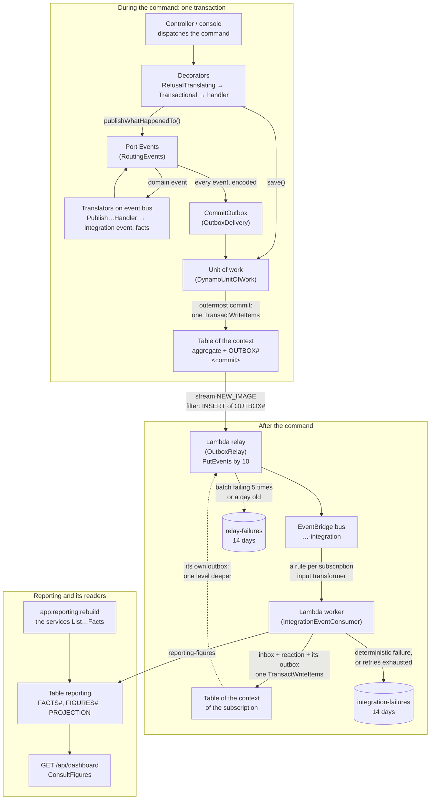
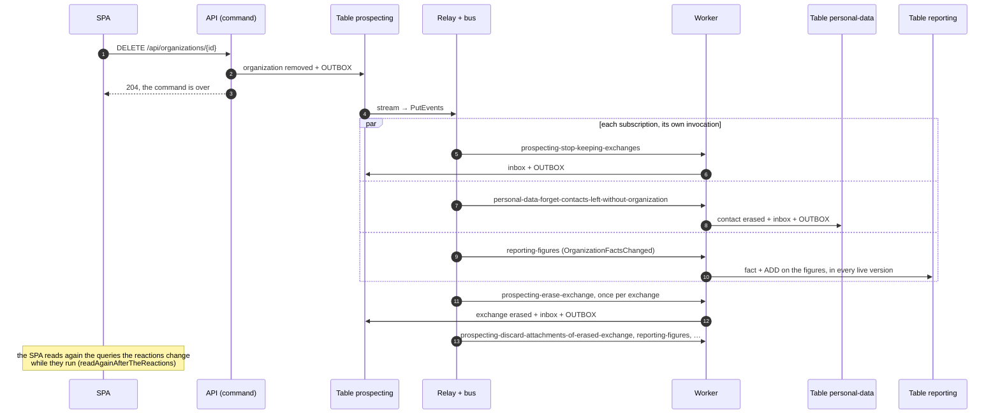
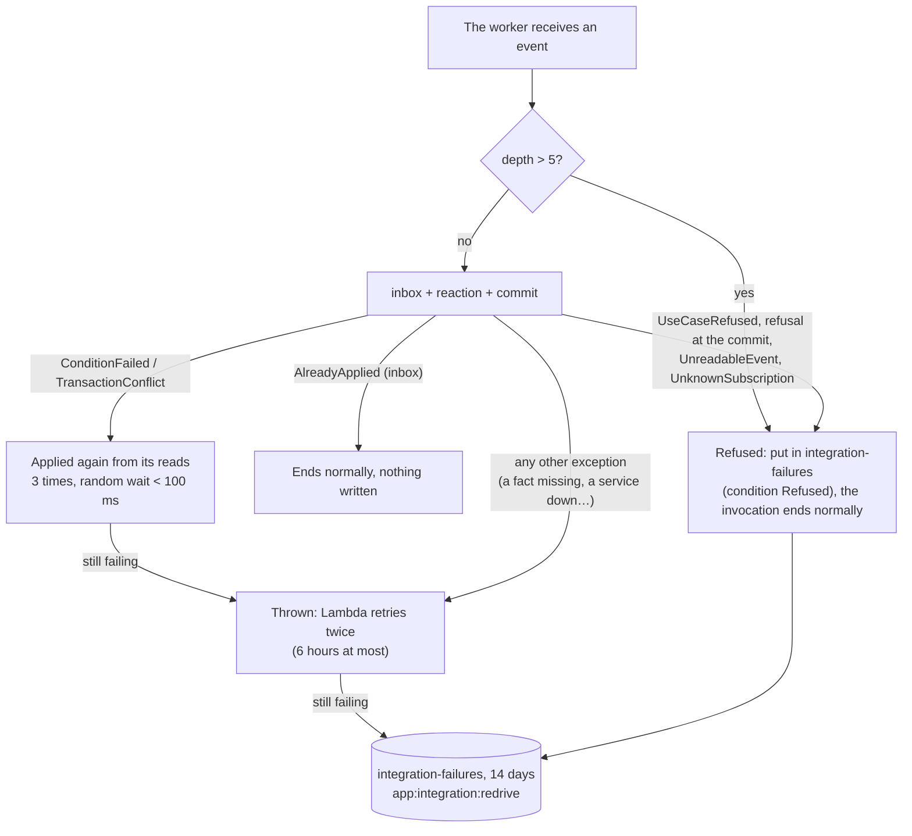

# The messaging between the contexts

What is in force; the reasons are in the records it names (`docs/adr`), read only to know why or before changing it (ADR 0090).

How a gesture of a member reaches the other aggregates and the other contexts: one transaction per command, its events written with it in an outbox, relayed to an EventBridge bus, given to a worker that runs each reaction in a transaction of its own. This document is the whole picture; the rules in detail live in their subjects: the format of the events, the subscriptions and the worker in [contexts.md](contexts.md), the unit of work, the outbox, the inbox and the table of Reporting in [persistence.md](persistence.md), the wiring of the API in [api.md](api.md), the resources on AWS in [infra.md](infra.md), the local emulation in [local-stack.md](local-stack.md) and [local-vs-aws.md](local-vs-aws.md).

## In short

1. **One transaction per command.** A command writes its aggregate and the outbox of its events in one `TransactWriteItems`, or nothing (ADR 0095, 0098).
2. **Every reaction runs after the command.** Internal to a context or between contexts, it runs in the worker, in its own transaction; the command answers as soon as its own is written, and never knows who reacts (ADR 0101).
3. **Nothing is lost once written.** The stream, the relay, EventBridge and Lambda retry, a bounded number of times; what keeps failing waits in a queue of failures for 14 days, never in the void (ADR 0098, 0101).
4. **At least once, in no order.** Each reaction is idempotent: by the inbox of its subscription, by the revision of a fact for Reporting, or by the state it reads again (ADR 0102, 0099).
5. **A domain event never leaves its context.** It travels under a source `.internal` that only the subscriptions of its context listen to; the other contexts get integration events, plain data of a `Contract` (ADR 0046, 0097).
6. **No loop.** Each event carries its depth; beyond 5 it is refused (ADR 0097).
7. **The figures are rebuilt from the state, never from stored events.** No event store, no archive: an event lives a week in its outbox, 14 days in a queue of failures (ADR 0096, 0103).
8. **Nothing is billed while nothing happens.** No poller, no hourly service: streams read by Lambda, EventBridge pushing, queues of failures without consumer, TTL deletions (ADR 0098).

## The picture



During the command nothing is written before the commit: the aggregate and the outbox go together, or not at all. The translators are the only handlers running within the command: they turn a domain event into what the others may know (an integration event, the facts of an aggregate), so that it is written in the same outbox. Then everything else is asynchronous.

## A gesture, step by step

Stopping the prospecting of an organization that has a contact and two exchanges, the longest chain of the platform:



Each exchange is erased by its own reaction, so that a gesture never exceeds the 100 writes of a transaction, whatever the number of exchanges (ADR 0095). On AWS a warm chain takes about 0.7 s from the answer of the API to the reaction written, about 3 s when the relay and the worker start cold (measured on dev, 2026-11-12).

## The vocabulary

| Term | Meaning |
|---|---|
| Unit of work | What a command or a reaction writes, kept in memory and sent in one `TransactWriteItems` (100 writes at most) at the outermost commit. Port `UnitOfWork` of the core, `DynamoUnitOfWork` in the API. |
| Domain event | What happened to an aggregate, in the words of its context (`ProspectingStopped`), identities only; `Domain/Event` of its context, never outside it. |
| Integration event | What a context promises the others (`ContactCollected`), plain data of its `Contract/Event`. |
| Facts | An integration event carrying the snapshot of an aggregate and its revision rather than an intention (`OrganizationFactsChanged`); a **terminal** fact (absent, revision 0) ends the aggregate (ADR 0099). |
| Revision | A counter the repository increments at each `save()`, unknown to the aggregate: the latest snapshot has the highest. |
| Translator | A `Publish…Handler`: on the synchronous `event.bus`, within the command, it turns a domain event into an integration event or facts. |
| Reaction | Any other `EventHandler`: it runs in the worker, after the command, reached as a subscription. |
| Subscription | An entry of `apps/api/config/subscriptions.json`, named `<context>-<intent>`: its sources, its events, its reaction(s), its inbox; a rule of the bus on AWS. |
| Outbox | The item `OUTBOX#<commit>` of the table of the emitting context, one per commit, holding all its events; forgotten a week later (TTL). |
| Relay | The function reading the streams of the tables and publishing the outboxes on the bus. |
| Worker | The function running the reactions, one invocation per event and subscription. |
| Inbox | The item `INBOX#<subscription>` / `<eventId>`, written with the effects of the reaction: an event applied once per subscription. |
| Delivery | `INTEGRATION_EVENTS_DELIVERY`: `outbox` (local stack, instances) or `sync` (tests). |
| Correlation, cause, depth | In the envelope of each event: the command it comes from, the event it reacts to, how many reactions away from the command. |

## The envelope

Every event, domain or integration, travels as an EventBridge event:

```json
{
  "source": "prospecter.personal-data",
  "detail-type": "ContactCollected.v1",
  "detail": {
    "eventId": "0196…",
    "occurredAt": "2026-11-12T16:43:54.700000Z",
    "correlationId": "0196…",
    "causationId": null,
    "depth": 0,
    "payload": { "personId": "…", "accountId": "…", "organizationIds": ["…"] }
  }
}
```

- `source`: `prospecter.<context>` for an integration event, `prospecter.<context>.internal` for a domain event; a domain event and an integration event of the same name (`AccountOpened`) are told apart by it.
- `detail-type`: the short name of the class and the version of its contract. A change of the payload bumps the version once an outbox or a queue of failures may hold the former shape, which is now always the case on the instances: `ExchangeFactsChanged.v2` carries the status of the exchange, `.v1` is still read (`FORMER_TYPES`).
- One `EventCodec` encodes both kinds, the classes listed in `DomainEventTypes` and `IntegrationEventTypes`; `EventCodecTest` fails for a class missing there.

## The subscriptions

| Subscription | Listens to | Inbox | Effect |
|---|---|---|---|
| `accounts-register-the-founder` | `AccountOpened` (.internal) | yes | the founder becomes a member |
| `personal-data-collect-founder-profile` | `AccountOpened` | yes | the empty profile of the founder |
| `personal-data-collect-member-profile` | `MemberRegistered` | yes | the empty profile of a member |
| `personal-data-forget-contacts-left-without-organization` | `ContactsLeftWithoutOrganization` | yes | a contact no organization names is erased |
| `prospecting-attach-collected-contact` | `ContactCollected` | yes | the contact attached to its organizations |
| `prospecting-detach-forgotten-contact` | `ContactForgotten` | yes | the contact detached from its organizations |
| `prospecting-keep-exchanges-of-forgotten-contact` | `ContactForgotten` | yes | its exchanges kept, to make conform |
| `prospecting-stop-keeping-exchanges` | `ProspectingStopped` (.internal) | yes | an `ExchangeLeftWithoutOrganization` per exchange |
| `prospecting-erase-exchange` | `ExchangeLeftWithoutOrganization` (.internal) | yes | the exchange erased |
| `prospecting-discard-removed-logo` | `LogoRemoved` (.internal) | no | the file leaves the storage |
| `prospecting-discard-removed-attachment` | `AttachmentRemoved` (.internal) | no | the file leaves the storage |
| `prospecting-discard-attachments-of-erased-exchange` | `ExchangeErased` (.internal) | no | its files leave the storage |
| `reporting-figures` | `OrganizationFactsChanged`, `ExchangeFactsChanged`, `ContactFactsChanged` | no | the facts and the figures of Reporting, a reaction per detail-type |

A subscription goes without inbox when applying its event twice changes nothing: a file removed again is absent, a fact of a revision known already is ignored. Two subscriptions to one event are two rules, two invocations, two inboxes: one never replays nor hides the other. `ReactionsAreSubscribedTest` keeps the list and the code together (every reaction subscribed, every subscription naming a known reaction and events its sources publish, an `.internal` source listened to by its own context only).

## When something fails



- **Deterministic failures are not retried**: another attempt would repeat them. They wait for a fix, deployed, then `app:integration:redrive`.
- **In doubt, a failure is retried**: a reaction missing an earlier fact (the order is no promise) throws and comes again later.
- **A reaction with nothing left to do ends without throwing**: an exchange erased already, an organization gone.
- **The relay** fails a whole batch when `PutEvents` refuses an entry; the mapping splits it, tries 5 times, keeps a record a day at most, then sends the metadata of the batch (not the events) to `relay-failures`; `app:outbox:republish --since=<moment>` publishes again the outboxes the tables still keep (a week).
- **A rule unable to invoke the worker** (permission, throttling) retries for a day, then puts the event in `integration-failures` too.
- No alarm watches the queues: `app:consistency:check` checks the result instead (below).

## Sync and outbox

| | `sync` | `outbox` |
|---|---|---|
| Where | the scenarios of the core, the tests of the API (`.env.test`), an instance naming it in its values | the local stack (`apps/api/.env`), the instances by default (ADR 0108), the worker always |
| Reactions | called at once, encoded and decoded through JSON, within the unit of work of the command | in the worker, after the commit, each in its own unit |
| A reaction refusing | refuses the gesture, nothing written | the gesture succeeds; the event ends in `integration-failures` |
| Inbox | none | per subscription |
| Limit | a gesture of many reactions may exceed 100 writes (stopping an organization of some thirty exchanges) | each reaction its own 100 |
| Delay | none: what the answer shows is complete | about a second |

The scenarios of the core reproduce the asynchronous order without a bus: `SynchronousEvents` delivers to the translators within the command, then to each reaction in its own unit once the command succeeded, a failure kept (`failuresOf()`) rather than refusing the gesture (ADR 0101, [tests.md](tests.md)). The tests of the API keep `sync`, so that a figure or an attachment is right as soon as the response comes; only the local stack, `make e2e` and the instances see the eventual consistency.

## What the members see

- **A command is not slower**: it stops at its commit, no reaction runs in the request.
- **What follows from a gesture comes about a second later**: a contact collected appears on its organization, the exchanges of an organization no longer prospected disappear, a figure of the dashboard moves. The SPA reads the queries a gesture's reactions change again at once and while they run (`readAgainAfterTheReactions`, `shared/api/reactions.ts`, [front.md](front.md)); the e2e journeys rely on the retried assertions of Playwright, never on a fixed pause.
- **A member signing in right after their registration** may find their profile not yet collected: the SPA shows « Votre profil est en cours de préparation… », reads it again with a growing delay, and after a minute « Réessayez plus tard »; then « Complétez votre profil » (ADR 0100).
- **A refusal of a reaction no longer refuses the gesture**: it is logged with its `reason`, kept in the failures, shown by `app:consistency:check`.

## Operating it

Every command runs locally with `make console CMD="…"`, on an instance with `INSTANCE=<instance>` from the command line, with the AWS profile of the instance, out of the 15 minutes of a function; it is refused while the local code lags behind the instance (ADR 0107).

| Command | What for |
|---|---|
| `app:consistency:check [--account=<id>]` | Reads only: the five figures recounted from the tables against Reporting, the effects of the reactions between the contexts, the keys listing the accounts and the exchanges, the queues of the failures. Lists each discrepancy and the command correcting it; fails when there is one (ADR 0105). |
| `app:integration:redrive` | Invokes the worker again with the `requestPayload` of each message of `integration-failures`, then deletes it. Safe: inbox and depth. |
| `app:outbox:republish --since=<moment>` | Publishes again the outboxes of the commits since the moment (a week at most). Safe: the reactions are idempotent. |
| `app:reporting:rebuild` | Counts every account again in a new version, then activates it: about two minutes of waits for the recordings in flight (ADR 0103, 0104, 0106). |
| `app:keys:rebuild` | Writes again the keys the tables derive from the aggregates, among them those listing the accounts and the exchanges the rebuild reads: before `app:reporting:rebuild` on an instance holding older items. |

| Symptom | Correction |
|---|---|
| A figure differs from the tables | `app:reporting:rebuild` |
| An account or an exchange missing from its list | `app:keys:rebuild`, then `app:reporting:rebuild` |
| A reaction missed, its event in `integration-failures` | fix the cause if it was refused, deploy, `app:integration:redrive` |
| A reaction missed, nothing in the failures | `app:outbox:republish --since=<moment of the gesture>` |
| A message in `relay-failures` | `app:outbox:republish --since=<moment of the batch>` |

The correlation of a gesture is in every log of the relay and the worker (CloudWatch on AWS, `apps/api/var/log/dev.log` locally): it follows a chain from the command to its last reaction.

## Adding an event or a reaction

1. **A domain event**: recorded by the intention method, in `Domain/Event` of its context, listed in `DomainEventTypes`.
2. **What another context must know**: an integration event in `Contract/Event` (plain data, importing nothing), its translator `Application/Publish…/Publish…Handler`, listed in `IntegrationEventTypes`, its scenario in the context.
3. **A reaction**: an `EventHandler` of the reacting context, translating the event into its words and calling an intention method as the member who acted; idempotent (its inbox, a revision, or the state read again); doing nothing when its object is gone; throwing when an earlier fact is missing.
4. **Its subscription** in `apps/api/config/subscriptions.json`, `<context>-<intent>`, `"inbox": true` unless applying twice is harmless. Locally `make db` or `deploy.sh relay` creates its rule; on AWS the next apply.
5. **A change of an existing payload**: a new version of the `detail-type` in `TYPES`, the former one moved to `FORMER_TYPES`, still read while outboxes or failures may hold it, a parameter added since read as null; the subscriptions listen to both. A change of what Reporting counts is followed by `app:reporting:rebuild` on each instance once deployed.
6. **A chain**: check its depth stays well under 5; a reaction publishing what triggers itself again would be stopped there, and refused.

## Limits and debt

- A reaction writes 100 items at most, its inbox and outbox included: a reaction on a set publishes an event per element instead (`ExchangeLeftWithoutOrganization`).
- A query on an index within a unit of work sees the table before the commit; only reads by key and partition queries see what the unit is about to write ([persistence.md](persistence.md#the-unit-of-work)).
- What is not DynamoDB is outside the transaction: a file sent to the storage by a use case whose unit is then discarded stays there, unused; files are removed only by reactions, after the state.
- No alarm on the queues of the failures: `app:consistency:check` is run by hand.
- `ExchangeFactsChanged.v1` is still read, and listened to by `reporting-figures`, until no outbox nor queue of failures of an instance holds it (14 days after the deployment of `.v2`, the queues empty).
- The worker shares the concurrency of the account with the API (no reservation); `BREF_LOOP_MAX` is off, PHP restarting for each invocation.
- On AWS, the split of a failing batch by the relay is configured but was never seen at work (a poisoned outbox, written on purpose on `dev`, was alone in its batch).
- A commit publishing in two contexts is refused: a gesture runs one use case (ADR 0100).
