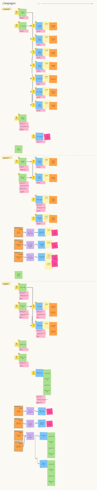

# Campaigns

Members put tags on their organizations and contacts. Later, they find the ones that carry them. A team prepares communication campaigns from these tags and runs them contact by contact (ADR 0138, 0144, 0145). Campaigns is downstream of Accounts, PersonalData and Prospecting, like Reporting. Code: `packages/core/src/Campaigns`.

## The wall

Each lane alone: [Campaign](../event-storming/campaigns/campaign.svg), [Recipient](../event-storming/campaigns/recipient.svg), [Tagging](../event-storming/campaigns/tagging.svg). The wall is drawn from the code (`make event-storming`, `docs/architecture/event-storming.md`). Its interactive page is served under `/docs/event-storming/campaigns/`: https://prospecter.localhost/docs/event-storming/campaigns/ locally, the same path on dev.

## Language

- **Tag** (`Tag`): a `#` followed by 1 to 30 characters. The characters are unaccented capital letters, digits and underscores (#ESN, #SALON_2026). A tag is written one way, whatever was typed. Accents are removed, and every other run of characters becomes an underscore. Nothing is left at either end (`Café owners` is #CAFE_OWNERS). Text that makes no tag is refused (`InvalidTag`).
- **Holder** (`Holder`): what carries tags, an organization (`OrganizationId`) or a contact (`ContactId`).
- **Tagging** (`Tagging`): the tags an account's members put **by hand** on one holder, sorted by name. It is Campaigns' source data.
- **Predefined tags** (`PredefinedTags`): tags proposed to every account, by family (`TagFamily`):
  - the organization type: #APPORTEUR #ESN #EDITEUR #FINAL #CABINET_RECRUTEMENT #PORTAGE #PARTENAIRE;
  - the relationship with a contact: #CLIENT #DECIDEUR #TECH #RH #ACHATS #ANCIEN_COLLEGUE #RECOMMANDE;
  - technologies: #PHP #SYMFONY #LARAVEL #JAVASCRIPT #TYPESCRIPT #REACT #VUE #ANGULAR #NODE #JAVA #DOTNET #PYTHON #GO #AWS #AZURE #GCP #DOCKER #KUBERNETES #DEVOPS #DATA #IA.

  They are only suggestions: an account's tag may have the same value.
- **Automatic tags** (`AutomaticTags`): the reserved tags Prospecter sets by itself. They are #EMAIL, #PHONE, #SMS, #LINKEDIN, the departments (#67, #2A, #971), the regions (#GRAND_EST…) and the surrounding big cities (#STRASBOURG…).
- **Geographic tags** (`GeographicTags`, ADR 0142): where an organization is. They come from the INSEE code of the municipality that its geocoding returned, and from its address's country (`Locality`). From the city outward, they are:
  - the attraction area of cities of 50,000 inhabitants or more that it belongs to (INSEE zoning AAV 2020). The tag is the area's label without « (partie française) ». A double name is kept whole: #MARSEILLE_AIX_EN_PROVENCE;
  - its department, taken from the start of its code;
  - its region.
- **Suggested tags** (`SuggestedTags`): the predefined tags by family, then the account's own tags. The account's own tags are the tags its holders carry that are not predefined. Next, separately, come the reach's automatic tags (#EMAIL #PHONE #SMS #LINKEDIN). Last come the geographic tags its organizations carry, sorted by name. These last two groups are for searching contacts, never for putting by hand.
- **Tag selection** (`TagSelection`): the tags a member chooses to find the contacts that carry every one of them. It holds 1 to 5 tags, each written as a tag. A tag typed twice is chosen once. Anything else is refused (`InvalidTagSelection`, « Choose from 1 to 5 tags »).
- **Fact** (`Fact`: `OrganizationFact`, `ContactFact`): the state that Campaigns derives contacts' tags from, with its revision. A Prospecting organization's fact says whether it is prospected, which contacts it names, and its `Locality`. A PersonalData contact's fact says whether it is kept and how it is reached. A **terminal** fact (absent) ends it (ADR 0141).
- **Reach** (`Reach`): how a contact is reached: an e-mail, a phone (possibly a mobile), a LinkedIn profile. It never holds the details themselves. It sets the automatic tags #EMAIL, #PHONE, #SMS and #LINKEDIN.
- **Campaign** (`Campaign`, `CampaignId`): a communication campaign of an account's team. Its author prepares it (`createdBy`). The members contact each person it targets themselves. Prospecter sends nothing (ADR 0144). A campaign has a name (`CampaignName`, 1 to 100 characters), a targeting, a message template and a status.
- **Channel** (`Channel`): how each contact is contacted: e-mail, call, SMS or LinkedIn. Each channel needs the means its automatic tag stands for: #EMAIL, #PHONE, #SMS, #LINKEDIN.
- **Targeting** (`Targeting`): the channel and the chosen tags (a `TagSelection`). Its **targeted tags** are the chosen tags plus the channel's tag. A tag chosen twice counts once. All of them fit within the 5 tags of a search.
- **Message template** (`MessageTemplate`): the text of an e-mail, SMS or LinkedIn message, or a call's pitch. The text has 5,000 characters at most. An e-mail also has a subject. The template's variables are `{title}` (Madame or Monsieur), `{firstName}`, `{lastName}`, `{organization}` and `{jobTitle}` (ADR 0190).
  - **Addressee** (`Addressee`): what a message calls a contact.
  - **Rendered message** (`RenderedMessage`): the message for one contact.
  - **Message mode** (`MessageMode`): how an AI running the campaign treats the message. The AI sends it **as is** (`asIs`, the default), as rendered for each person. Or the AI **adapts** it (`adapted`) to each person, and keeps its idea (ADR 0186).
- **Campaign status** (`CampaignStatus`): draft, then frozen, started, and ended or stopped (ADR 0144). What each status allows (`CampaignIntent`, `CampaignPossibilities`):
  - a draft is revised, discarded and frozen;
  - a frozen campaign is revised (its name and message) and discarded. Its recipients are added and removed. It is started while it keeps a recipient;
  - a started campaign is run (`RunCampaign`) and stopped;
  - until a campaign is stopped or ended, its daily cap is set (`SetDailyCap`);
  - a stopped or ended campaign allows nothing.

  A campaign **has started** once it is started, stopped or ended. Its name, its message and its recipients then no longer change. Only a started campaign's daily cap still does. A campaign **is running** (`isRunning`) while it is started.
- **Recipients** (`Recipients`, `Recipient`, `RecipientStatus`): the contacts a frozen campaign keeps. The campaign keeps them by identity only, because their names belong to PersonalData. It keeps each one once, in the order added. Each one has a status that says where the team stands with them:
  - to handle (`pending`);
  - **processed** (`processed`) by the exchange logged for them in the campaign. That exchange is done, or missed for a call that did not go through. The identity of that exchange is kept (ADR 0152);
  - **dismissed** (`dismissed`) without an exchange, for a reason when one is given;
  - no longer to handle (`erased`): PersonalData erased the contact from a started campaign while they were still to handle.

  An **erased** recipient is kept without their name (ADR 0145). What the team did with them stays: processed, missed or dismissed. The exchange and the reason do not stay.
- **Progress** (`CampaignProgress`): the processed and dismissed recipients, out of all of them. It also counts the recipients processed today, on the member's clock.
- **Daily cap** (`DailyCap`): the most recipients of a campaign processed in a day, 1 or more. It keeps the member's mailbox or LinkedIn account from being flagged. It is only a guard. An AI stops at it and asks its member, who may go beyond it. A campaign may have no cap.
- **A contact's tags** (`ContactTags`):
  - its own tags, put on it by hand;
  - the tags it **inherits** from the organizations that name it. These are the tags put by hand on those organizations, and the tags set by where they are (`InheritedTag`, with those organizations);
  - the **automatic** tags of its reach.
- **An organization's tags**: the ones put by hand, then the automatic ones for where it is.

## Rules

- A member tags an organization their account prospects, or a contact of their account (`PutTags`). Prospecting and PersonalData tell which ones these are (`TaggableHolders`). Anything else is unknown (`UnknownOrganization`, `UnknownContact`). Every prospector tags, with or without the right to manage personal data.
- A tag already carried is carried once. An automatic tag is never put by hand (`AutomaticTag`, « The tag #EMAIL is set automatically »). Such a tag refuses the whole action.
- A member takes a tag off (`TakeOffTag`). This is refused when the organization or contact does not have the tag (`TagAbsent`).
- The suggested tags (`ConsultSuggestedTags`) are derived from the tags carried. A tag that nothing carries any more is no longer suggested. Another account's tag is never suggested.
- An organization's tagging is forgotten once Prospecting says the account no longer prospects it. `ForgetTagsOfUnprospectedOrganizationPolicy` sends `ForgetTagsOfUnprospectedOrganization` for its terminal `OrganizationFactsChanged`. A contact's tagging is forgotten once PersonalData says the contact is forgotten. `ForgetTagsOfForgottenContactPolicy` sends `ForgetTagsOfForgottenContact` for `ContactForgotten`. So when the account stops prospecting an organization, its tags go with it. The tags of the contacts it erases go too.

- A contact carries the tags put by hand on each organization that names it. These follow the organizations' tags, and the contacts attached and removed. A contact may carry a tag by hand and also inherit it. That tag is then its own, shown once. An inherited tag names every organization it comes from (`ContactTags`).
- A contact carries #EMAIL with an e-mail, #PHONE with a phone, #SMS when that phone is a mobile (libphonenumber), and #LINKEDIN with a LinkedIn profile. These are never put on or taken off by hand. Every prospector reads them, with or without the right to manage personal data. A prospector reads them for their own account's contacts only (`ConsultContactTags`, a set; `UnknownContact` otherwise).
- An organization carries its municipality's geographic tags (ADR 0142):
  - a municipality may belong to an attraction area of 50,000 inhabitants or more. Then the organization carries the surrounding big city, plus its department and region;
  - outside such an area, or in a municipality more recent than the tables, it carries only its department and region;
  - an arrondissement of Paris, Lyon or Marseille counts as its city;
  - a municipality merged since 2020 keeps the tags of its last geography;
  - it carries nothing without a municipality (an address the geocoder did not find). It also carries nothing when its address's country is given and is not French (FR, GP, MQ, GF, RE, YT), whatever the geocoder found.

  Its contacts inherit them. Every prospector reads them (`ConsultOrganizationTags`) and never puts them by hand.
- A contact's tags are derived when they are read, from the facts that Campaigns keeps (ADR 0141). A received fact replaces its aggregate's known fact when its revision is higher. The terminal fact replaces any other, and no fact replaces it. A fact received twice counts once (`FactSuccession`, `FactRecorder`). The first version of the facts did not carry the contacts and the reach. A fact published in that version is not recorded.
- A member finds their account's contacts that carry every chosen tag (`SearchContactsByTags`). Own, inherited and automatic tags count alike. `ContactTags` derives them for each contact that its fact keeps. Results come newest first, as a slice after a cursor, with the total count (ADR 0143). Every prospector searches by tags, with or without the right to manage personal data. PersonalData then reads the contacts as the prospector may read them.
- A member prepares a campaign of their account (`PrepareCampaign`) as a draft. The draft has a name, a channel, at least one chosen tag and a message. It is refused:
  - without a name (`CampaignWithoutName`, « A campaign needs a name »);
  - with a name of more than 100 characters (`CampaignNameTooLong`);
  - with an unknown channel (`UnknownChannel`);
  - with no tag, or more than 5 counting the channel's tag (`InvalidTagSelection`);
  - with a message of more than 5,000 characters (`MessageTooLong`);
  - with a subject for a channel other than e-mail (`SubjectOnlyForAnEmail`);
  - with a message mode other than as is or adapted (`UnknownMessageMode`, « An AI can only send the message as is or adapted »);
  - with a daily cap below 1 (`InvalidDailyCap`, « A daily cap must be at least 1 send »). When no cap is given, the campaign has none.

  The mode is as is when it is not given. It is revised with the message until the campaign starts.
- A draft targets the account's contacts that carry every one of its targeted tags, as `ContactTags` derives them now. Nothing of its target is stored. The target follows the contacts' tags and contact details (ADR 0144). The screen reads it as the tag search for its targeted tags.
- Any team member revises a whole draft (`ReviseCampaign`) or discards it (`DiscardCampaign`), whoever prepared it. What the campaign's state does not allow is refused (`NotPossibleInItsState`). Another account's campaign is unknown (`UnknownCampaign`).
- A member freezes a draft (`FreezeCampaign`). The contacts its search finds now become its recipients, for good. This is refused when the search finds nobody (`CampaignWithoutRecipient`, « A campaign needs at least one recipient »). It is also refused when the search finds more than 500 contacts (`TooManyRecipients`). Once the campaign is frozen, the list no longer follows the tags. The channel and tags no longer change (`FrozenSearch`, « A frozen campaign's search can no longer change »). Its name and message still change, and it can still be discarded.
- A member adds recipients to a frozen campaign in two ways. They add the contacts that another tag search finds, with the channel's tag added (`AddRecipientsByTags`). Or they add one chosen contact (`AddRecipient`). A contact without the means its channel needs is refused (`UnreachableContact`, « Grace Hopper cannot be reached by email »). The refusal names the contact as the member reads them. Someone who is not a contact of the account is refused too (`UnknownContact`). A contact already kept is kept once, and a campaign keeps 500 at most. A member removes a recipient (`RemoveRecipient`), but never the last one (`CampaignWithoutRecipient`). A contact that the campaign does not keep is unknown (`UnknownRecipient`).
- A contact that PersonalData forgets leaves the recipients of every frozen campaign that keeps it (`ForgetRecipientOfForgottenContact`, which its policy sends for `ContactForgotten`). This holds even when it is the last one: a person's erasure wins over the team's list. A frozen campaign emptied this way is in effect cancelled. It stays frozen with no recipient, and is listed as such. It can still be discarded. It does not start while it keeps none (`CampaignWithoutRecipient`, « A campaign needs at least one recipient »).
- A campaign that has started keeps the forgotten contact, without its name (« Contact effacé » on the screen). The erasure takes the contact's identity, never what the team did:
  - a processed recipient (missed or not) or a dismissed one stays so, and counts in the progress;
  - a recipient still to handle no longer is (`erased`);
  - the exchange it links to is not kept, and neither is its dismissal reason. Both may say something about the person;
  - a running campaign then ends once nobody is left to handle (ADR 0145).
- A member starts a frozen campaign (`StartCampaign`), and the moment is kept. Its recipients, message and channel no longer change (`StartedCampaign`, « A started campaign can no longer change »). It can no longer be discarded (`StartedCampaignNotDiscarded`, « A started campaign can be stopped, not deleted »). Only a frozen campaign starts (`CampaignNotFrozen`, « Only a frozen campaign can start »). Neither a draft nor a stopped one starts. A member stops a started campaign (`StopCampaign`), and the moment is kept. The campaign stays listed and allows nothing more.
- A member runs a started campaign one recipient after another (ADR 0145). They log an exchange in the campaign for a recipient to handle (Prospecting's `NoteCampaignExchange`). That exchange's facts process the recipient, done or missed (`ProcessRecipientOfCampaignExchange`, which its policy sends for an `ExchangeFactsChanged` of a campaign, done or missed). Or the member dismisses the recipient without an exchange (`DismissRecipient`, for a reason when one is given).
  - Only a started campaign can be run (`CampaignNotRunning`, « Only a started campaign can be run »).
  - A recipient is handled once (`RecipientAlreadyProcessed`, « This recipient has already been processed »).
  - A contact who is not a recipient is unknown (`UnknownRecipient`).

  Once nobody is left to handle, the campaign is **ended**, and the moment is kept. It allows nothing more. Processing is a system reaction. A recipient already handled, a campaign no longer running, or an exchange of no campaign changes nothing. Nothing is recorded then.
- A processed recipient links to the exchange logged for them, and the exchange links to its campaign (ADR 0152). A member may erase that exchange. The recipient then goes back to handle (`ReopenRecipientOfErasedExchange`). Its policy sends it for the exchange's last `ExchangeFactsChanged`, absent, which names its campaign and its contact:
  - an ended campaign is started again. A stopped one stays stopped;
  - an exchange may be erased with its organization, when the account stopped prospecting the last organization that kept it. Such an erasure never reopens the recipient: the recipient stays processed without the exchange (ADR 0155);
  - another exchange of the recipient changes nothing. Neither does a recipient erased since, or an erased campaign.

  This is a system reaction: nothing is recorded. A campaign that the operations erase leaves its exchanges in their timelines. No campaign names them any more.
- The operations erase a campaign whatever its status (`EraseCampaign`, `app:campaign:erase <id>`). They do so to clean up a test, or on a person's request. They find the campaign by its identity alone, across the accounts (`TaggedAccounts`). No member does this: the application never deletes a started campaign.
- An account's campaigns are listed whole, newest first (`ListCampaigns`, `ConsultCampaign`, `CampaignTargets`). Each one comes with the count of contacts it targets. For a draft, these are the contacts its search finds now. Every contact's tags are derived once for that count (`TagsOfEveryContact`, ADR 0144, 0143). For a frozen campaign, they are its recipients. Each campaign shows its processed and dismissed recipients, and none before it starts (`CampaignProgress`).
- A member sets the daily cap of a draft, a frozen or a started campaign, or takes it off (`SetDailyCap`). A cap below 1 is refused, as at preparation. A stopped or ended campaign does not change (`StartedCampaign`). A recipient is processed at the moment its exchange's facts tell it. An erased recipient still counts. The recipients processed today are those processed on the member's day, on their clock. The screen reads them on the campaign (`ConsultCampaign`, with its daily cap). Going beyond the cap is never refused.
- An AI runs a started campaign for its member (ADR 0186).
  - It asks for the next recipient (`NextRecipient`), on its member's clock. The answer is the first recipient still to handle, in the order they were added. It comes with the message rendered for them, its subject and its mode. It also gives how many recipients are left, the daily cap and the recipients processed today.
  - Once the cap is reached, the recipient is still given, and the answer says the cap is reached. The AI stops and asks its member whether to go beyond it.
  - `NextRecipient` is refused once the campaign is no longer running (`CampaignNotRunning`).
  - The campaign is read again at each step. So a recipient handled on the screen meanwhile is no longer returned.
  - Prospecting may have logged an exchange of the campaign with a recipient before the reaction processes them. Such a recipient is not returned either. `NextRecipient` asks Prospecting about them (`CampaignExchanges`, through `WhichContactsHaveExchangesOfCampaignService`). The next recipient and the count left pass over them. When nobody else is left, `NextRecipient` is refused as no longer running (ADR 0195).
  - The AI sends the message itself. Then it logs the message as the recipient's exchange (`NoteCampaignExchange`, logged once), with the text it actually sent. The import of Gmail may have logged the e-mail first. That e-mail joins the campaign when the AI logs it (ADR 0195).
  - Or the AI dismisses the recipient, for a reason.
- The core renders a campaign's message for a contact of the account (`RenderCampaignMessage`). Each variable takes what is known of the contact. The names, title and job title come as PersonalData lets the member read them. The organization is the first one that Prospecting lists for them. A variable takes nothing when nothing is known. Any other text is kept. The subject is rendered the same way. A person whom the member reads as not a contact of the account is unknown (`UnknownContact`).
- Only a member with the right to manage personal data runs campaigns, for every action and every read. The API requires it (ADR 0081). The core checks no role.
- A rebuild records again the facts of every account, or of one (`RebuildTags`). It takes them as Prospecting and PersonalData give them from their state. It goes through the same succession, with one exception. A rebuilt fact replaces a kept fact at the same revision, because the kept one may have been recorded before the facts carried what they carry now (ADR 0184). Each fact is its own unit of work, without a version or a wait.

## What it publishes

- The service `WhichRecipientsArePendingService`: whether an account's campaign has started, and its channel. It also tells which of the asked contacts the campaign keeps as recipients and still has to handle. An unknown campaign is absent. Prospecting asks it before logging a recipient's exchange (ADR 0145).
- The service `NameCampaignsService`: the names of an account's campaigns. An unknown campaign is absent. Prospecting asks it to name the campaign of the exchanges in a timeline (ADR 0145).

Its domain events stay in the context: `OrganizationTagsChanged`, `ContactTagsChanged`, `CampaignPrepared`, `CampaignRevised`, `CampaignDiscarded`, `CampaignFrozen`, `CampaignRecipientsChanged`, `CampaignStarted`, `CampaignStopped`, `DailyCapSet` and `RecipientDismissed`.

## Features

`taguer-mes-organisations-et-mes-contacts`, `porter-les-tags-de-mes-organisations-et-de-mes-coordonnees`, `porter-les-tags-de-l-adresse-de-mes-organisations`, `rechercher-mes-contacts-par-tags`, `preparer-une-campagne`, `figer-les-destinataires-d-une-campagne`, `demarrer-et-arreter-une-campagne`, `mener-une-campagne`, `fixer-un-plafond-d-envois-par-jour`.

## In the code

- `src/Campaigns/Domain`:
  - `Tag`, `Holder` and `HolderKind`, `OrganizationId` and `ContactId` (Prospecting's organizations and PersonalData's persons, ADR 0197), `TagFamily`, `TagSelection`, the aggregate `Tagging`;
  - the facts (`Fact`, `OrganizationFact`, `ContactFact`), `Reach`, `Locality`, `ContactTags` and `InheritedTag`;
  - the rules `PredefinedTags`, `AutomaticTags`, `GeographicTags` and `FactSuccession`. `bin/insee-geography.php` generates the tables of `GeographicTags` from INSEE data, in `data/insee-geography.php`. Nobody edits them by hand;
  - the domain service `TaggableHolders`;
  - the aggregate `Campaign`. Its identity is `CampaignId`. Prospecting has its own `CampaignId` for the campaign an exchange was logged in (ADR 0197);
  - the campaign's value objects:
    - `CampaignName`, `Channel`, `Targeting`, `MessageTemplate`;
    - `CampaignBrief`: its name, targeting and message, as a member prepares or revises them;
    - `Candidate`: a contact added by hand, with their tags and their `Addressee`;
    - `MessageMode`, `Addressee`, `RenderedMessage`, `CampaignStatus`, `CampaignIntent`;
    - `Recipients`, `Recipient` (it keeps, among other things, when it was processed), `RecipientStatus`;
    - `RecipientOutcome`: how the exchange that processed a recipient went, done or missed;
    - `DailyCap`;
  - the rules `CampaignPossibilities` and `CampaignProgress`. `CampaignProgress` counts the processed and dismissed recipients, and those processed on the member's day;
  - the repositories `TaggingRepository`, `FactRepository` and `CampaignRepository`;
  - the ports, implemented by anticorruption layers:
    - from Accounts: `Campaigners` (a member's account), `Taggers` (a member's account), and `TaggedAccounts` (the accounts whose tags are rebuilt, and among which a campaign is erased);
    - from PersonalData and Prospecting: `Addressees` (what a message calls a contact);
    - from Prospecting: `TaggableOrganizations`, `OrganizationsAndTheirContacts`, and `CampaignExchanges` (which recipients have an exchange of the campaign, ADR 0195);
    - from PersonalData: `TaggableContacts` and `ContactsReach`.
- `src/Campaigns/Application`, in three modules (ADR 0206):
  - `Tagging`, the tags on organizations and contacts: `PutTags`, `TakeOffTag`, `ConsultOrganizationTags`, `ConsultContactTags`, `ConsultSuggestedTags` (`SuggestedTags`), `SearchContactsByTags` (`TaggedContactPage`), `RecordOrganizationFacts` and `RecordContactFacts` through `FactRecorder`, `RebuildTags` without a command's unit of work, `ForgetTagsOfUnprospectedOrganization` and `ForgetTagsOfForgottenContact`;
  - `Campaign`, a campaign's life: `PrepareCampaign`, `ReviseCampaign`, `DiscardCampaign`, `ListCampaigns` and `ConsultCampaign` (`CampaignTargets`), `RenderCampaignMessage` (`CampaignMessage`), `FreezeCampaign`, `StartCampaign`, `StopCampaign`, `SetDailyCap`, `EraseCampaign`, and the published query `NameCampaigns`;
  - `Recipient`, who a campaign reaches and how each is handled: `AddRecipientsByTags`, `AddRecipient`, `RemoveRecipient`, `DismissRecipient`, `NextRecipient` (`RecipientToHandle`), `ProcessRecipientOfCampaignExchange`, `ReopenRecipientOfErasedExchange`, `ForgetRecipientOfForgottenContact`, and the published query `WhichRecipientsArePending`;
  - at the application's root, what both `Campaign` and `Recipient` read: `CampaignSheet` and its `RecipientInSheet`, and `TagsOfEveryContact`;
  - the policies of `Policy/`, which turn the other contexts' events into the commands `ForgetTagsOfUnprospectedOrganization`, `ForgetTagsOfForgottenContact`, `ForgetRecipientOfForgottenContact`, `ProcessRecipientOfCampaignExchange`, `ReopenRecipientOfErasedExchange`, `RecordOrganizationFacts` and `RecordContactFacts` (ADR 0203). `RecordFactsPolicy` takes the facts of an organization or a contact;
  - the ports:
    - `TagsRetriever`: the taggings, and where the organizations are (`localityOf()`, `localitiesIn()`);
    - `ContactTagsRetriever` and `TaggedContactsRetriever`;
    - `CampaignSheetRetriever`: a campaign found or not, and the names of some (`RecipientInSheet`);
    - `ContactTagSources`: it derives its contact's tags. Among the inherited ones, these include the tags for where its organizations are.
- In the API: its table and items in `docs/architecture/persistence.md`, its endpoints in `docs/architecture/api.md`, its subscriptions in `docs/architecture/contexts.md`, `app:tags:rebuild` in `docs/architecture/messaging.md`.
