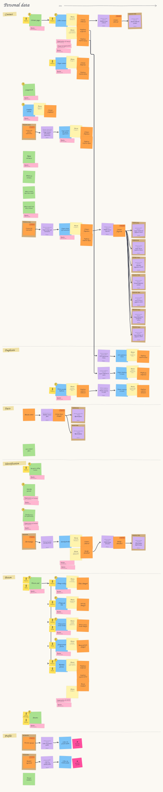

# PersonalData

Natural persons' personal data, and who reads it. Code: `packages/core/src/PersonalData`.

## The wall

Each lane alone: [Contact](../event-storming/personal-data/contact.svg), [Duplicate](../event-storming/personal-data/duplicate.svg), [Facts](../event-storming/personal-data/facts.svg), [Identification](../event-storming/personal-data/identification.svg), [Person](../event-storming/personal-data/person.svg), [Profile](../event-storming/personal-data/profile.svg). The wall is drawn from the code (`make event-storming`, `docs/architecture/event-storming.md`). Its interactive page is served under `/docs/event-storming/personal-data/`: https://prospecter.localhost/docs/event-storming/personal-data/ locally, the same path on dev.

## Language

- **Person** (`Person`): a natural person's personal data, kept for one account and one purpose:
  - their name (`PersonName`: a first name and a last name). The name is trimmed at both ends, with one space between words. A name made of nothing but spaces is absent;
  - a contact's title;
  - their job title;
  - their contact details;
  - their links;
  - their picture.
- **Link** (`ExternalReference` from the shared kernel): the address of a page about the person on an outside tool (LinkedIn, Malt or any other site). It is logged with their contact details. A person has five links at most, and none is required.
  - A link is recognized by its **source** and its **identifier**. Both are normalized to one form, however the address was pasted. The source is `linkedInProfile` or `malt` for a profile there. For a tool Prospecter does not know, the source is the address's host. The identifier is the address in its normalized form. The pasted address is kept, to open it.
  - Two kinds of address are refused. The first is a known tool's page that designates an organization (a LinkedIn or Welcome to the Jungle company page). The second is an address on a known tool's site that is none of its recognized pages.
  - A link belongs to a contact or to a member.
  - A person keeps their last three **former links**, whatever their source. These are the links they had before changing or removing them. Former links still recognize the person. They are never shown nor published. They are forgotten with the person (ADR 0139, 0159, ADR 0165).
- **Title** (`Civility`): how to address a contact when their first name does not tell. It is Ms or Mr (Madame or Monsieur to the member), or X while it is unknown.
  - It is never absent. It is X for a contact collected without one, for a person saved before titles were logged, and when a member removes it. Any other value is refused.
  - It is logged for contacts only: a member's profile keeps X.
- **Purpose** (`Purpose`): why the account keeps the person. It is a member's own profile (`Membership`), or a person the account prospects (`Prospecting`).
- **Contact**: a person an account prospects. A contact works in at least one of the organizations the account prospects.
- **Possible duplicate**: a contact of the account whom another contact resembles, by first and last names, in one of their organizations (`PersonResemblanceKey`). They may be the same person, logged twice. Both are flagged, and nothing is refused. The flag stays until a member checks and says it is not a duplicate (ADR 0170).
- **Reader** (`Reader`): a member as PersonalData sees them. A reader has an account and a person of their own. A reader holds the right to read personal data unmasked, or does not.

## Rules

- No other context keeps personal data, only an identity of its own for the person (ADR 0197). The exceptions:
  - the text and attachments of Prospecting's exchanges, which may hold some (ADR 0031, 0074, 0077). A meeting's place and a video call's link are not personal data (ADR 0114);
  - the address of the account a member connects at a provider. Connectors keeps it for that member alone, and forgets it when they disconnect (ADR 0120);
  - the person who booked an appointment through a public link, as they described themselves. Booking keeps them for 16 days at most, until PersonalData identifies them (ADR 0164).
- Another account does not even learn that a person exists. The person themself reads their data unmasked, and so does a member of the account with the right. Other members read the data masked (`PersonReading`, `Masking`; ADR 0031, ADR 0165):
  - a fixed number of stars, so that the length of a name or an address does not leak;
  - their links as a single link of stars, whatever their number.

  The exception: every member of the account reads a contact's name and title unmasked. The rest of the contact stays masked (`PersonReading::ofTheName()`; ADR 0129).
- A member's profile is collected empty when their account is opened or when they are registered. The member fills it in themselves. At their first sign-in, the SPA asks for their name and their profile's email. It proposes their login email (`CollectTheFounderProfile`, `CollectTheMemberProfile`; ADR 0064, 0075, 0100).
- A person changes their own data. A member with the right changes the persons their account prospects, but not a colleague's profile. Only a prospected person can be forgotten or have a title. A member with the right logs that title (`PersonPossibilities`; ADR 0031, 0075).
- A member with the right collects a contact for at least one organization the account prospects. A contact is never alone. When no organization names a contact any more, the contact is erased (`CollectContact`, `ForgetContactsLeftWithoutOrganization`; ADR 0041, 0042). The contacts list offers to collect one only to a member with the right (`ContactsIntent::Collect`, `Reader::contactsIntents()`). The member then chooses its organization in the same form.
  - The exception is a contact to attach. A member with the same right collects it without an organization, for the member who met them (`Person::collectToAttach`). That member forgets it when Prospecting reports that nobody attached it in time (`ForgetContactLeftUnattached`, ADR 0146).
  - A contact to attach is one of the account's contacts. It is counted, tagged and targeted like any other.
- A person who booked a slot through a host's public link is identified (`IdentifyBooker`, ADR 0164, 0199), in the host's account only. PersonalData looks for them in this order:
  1. the account's contact who has their e-mail, whatever its case;
  2. otherwise, a new contact to attach. It is collected for the host from what the booker typed: their name, e-mail and phone. This holds even when the phone is a contact's.

  So the invitation goes to the address the booker typed (ADR 0175). This rule covers booking only: identifying a person elsewhere does not change.

  The identified person is published (`BookerIdentified`).
- A member with the right to manage personal data completes a contact with what a client knows about them (`CompleteContact`, ADR 0177).
  - Only empty fields are filled: the title, job title, email and phone number. The links are filled while there is room among the five. Nothing already logged is overwritten. Nothing changes when there is nothing to fill.
  - The email and the links stay unique among the account's contacts.
  - Beforehand, `CompareWithContact` applies the same rule and reports two lists. The first lists the fields it would fill. The second lists the fields given with a value other than the one logged.
- A person is identified from the clues a client gives about them (`IdentifyPersons`, ADR 0173). It only reads. It takes a whole list at once, in its order, and searches the account's contacts.
  - It first uses the person's keys, the surest first (`PersonKeys`): each link, current or former, each email and each mobile. A landline is not a key, because a whole organization shares it.
  - If the keys designate one contact, the person is **known**. If they designate several, or a mobile shared by two contacts, the person is **to confirm**, never known.
  - If they designate none, the person's resemblance key finds homonyms. It looks first in the organizations the client says the person works for. The person is then to confirm.
  - Otherwise, the person is **new**.
  - Without the right to manage personal data, a reader identifies a person by their names only (`Reader::identifiesByPersonalData()`). Otherwise, a reader of masked data could guess what they cannot read.
  - A clue that is not a valid key of its kind designates nobody. It does not cause the list to be refused.
- Persons and the organizations they work for are identified together (`IdentifyPersonsAndOrganizations`, ADR 0173, 0217). Prospecting identifies the organizations first, through its published service `IdentifyOrganizationsService`. Each person names the organization they work for by its position in the list. They are identified as above, first among the contacts of that organization's candidates. A position outside the list names no organization.
  - A candidate is given by their id and their name, which every member of the account reads.
- A contact keeps their origin (`Origin` from the shared kernel). A member logged them by hand, or an AI logged them while acting as the member through the MCP server. The AI is never named. `CollectContact` takes the origin (`byAnAI`), and only the MCP server's tools set it. Completing the contact keeps the origin, even when an AI completes it. The contact's card shows it (`createdByAnAI`, ADR 0185).
- An email is unique among the persons an account keeps for a purpose (`EmailUniqueness`; ADR 0039).
- A contact can be suspected of being a duplicate when they are collected or renamed. They are suspected of each account contact that shares their resemblance key, in an organization that names both. The resemblance key is their first and last names, ignoring case, accents and spaces. Prospecting tells which organizations name them (`DuplicateSuspicion`, the port `OrganizationsOfContacts`, the events `DuplicateSuspected` and `DuplicateSuspicionLifted`).
  - The suspicion is lifted for the contacts they no longer resemble.
  - There is no suspicion without both names, nor for a member's profile.
  - In return, a policy makes the other contact suspect the person, or lift its suspicion of them (`SuspectDuplicateInReturn`, `LiftSuspicionInReturn`).
  - Being suspected or lifted does not change a contact's modification time.
  - Forgetting a contact lifts their suspicions.
  - Only a member with the right to manage personal data reads who is suspected (`PersonReading::showsPossibleDuplicatesTo()`). After checking, that member says that a contact is not a duplicate of one they are suspected of (`DismissPossibleDuplicate`). Any other contact is refused (`NotASuspectedDuplicateContact`). The two are never suspected of each other again (`DismissSuspicionInReturn`, ADR 0170).
- A link designates one contact in an account, through their current links or a former one (ADR 0159, ADR 0165).
  - Collecting a contact with a link another contact holds is refused, and so is logging such a link on a contact. The refusal names that other contact (`ReferenceUniqueness`, `ReferenceAlreadyUsed`).
  - Another account may log the same link, and so may a member for their own profile.
  - A contact keeps a link they already hold. So two contacts who logged the same link before the rule block nothing. `app:consistency:check` lists them, for the members to merge or correct.
- Two searches need the right to manage personal data: searching contacts by the beginning of their email, and recognizing a caller by their phone number. Otherwise, a reader of masked data could guess what they cannot read (ADR 0031, 0072). Without the right, a reader searches contacts by the beginning of their name only (`Reader::searchesTheEmails()`; ADR 0129).
- A contact is found by the beginning of their last name or of their first name, with or without an email. A contact is never found by the first name followed by the last name (ADR 0071, 0149).
- Forgetting a contact erases their person. Their exchanges stay in Prospecting, to be redacted (ADR 0079).
- A member presents themselves to the people they give a link to. They show their name and their picture unmasked, which are theirs to give. A person the account prospects is never presented (the rule `MemberPresentation`, ADR 0153).

## What it publishes

- The service `WhichAreContactsService`: which persons are an account's contacts. Prospecting asks it (ADR 0089).
- The service `WhichContactsHaveTheseEmailsService`: which of an account's contacts have the given addresses, whatever their case. It answers through the reservations of their emails. A forgotten contact is absent. Connectors asks it to recognize who an e-mail was exchanged with. The address never leaves the question (ADR 0154).
- The service `WhichEmailsHaveTheseContactsService`: contacts' addresses, as a member reads them. A contact without an address gets none. It answers only a member who reads addresses unmasked, because they are allowed to manage their account's personal data. A contact they do not read is absent. Connectors asks it to reimport the e-mails that member's mailbox exchanged with a contact. Connectors passes the address to the provider in its search, and does not keep it.
- The other contexts' views show persons only through PersonalData, asked with the member who reads, and keep no personal data, a materialized view included (ADR 0217). A view of another context that shows persons only to enrich what that context decided is a composition of the API: PersonalData answers its own query (`ConsultPersons`), asked with the member who reads, and the API joins the answers by the persons' ids (`docs/architecture/api.md`). A forgotten person is absent, and so is a person the member does not reach. Prospecting's views answer with their contacts' and members' ids, and the API names them so.
- The service `NameContactsService`: persons' names and job titles as a member reads them, unmasked or masked. It also gives a contact's title, unmasked like their name. It gives their e-mail and phone only when the member reads them unmasked. A forgotten person is absent, and so is a person the member does not reach. Connectors asks it to name the contact of an exchange it pushes (ADR 0127). Connectors also asks it to invite the booker of a booked exchange (ADR 0175). Campaigns asks it to render a campaign's message for a contact (ADR 0144).
- The service `PresentMembersService`: members' names and pictures, unmasked. It checks no caller. A prospected, forgotten or unknown person is absent. Booking asks it to say who a public page's host is (ADR 0153).
- The integration events `ContactCollected` and `ContactForgotten` (ADR 0046).
- Its contacts' facts: whether each contact is present, and how each one is reached. The means are an e-mail, a phone, a mobile (as libphonenumber types the number) and a LinkedIn profile among their links. These facts are booleans, never the details (ADR 0141). They are published each time one changes (`ContactFactsChanged`). They are also published by slice for an account (`ListContactFactsService`). A context uses them to count contacts or derive from them without reading PersonalData's tables (ADR 0099). A forgotten contact gives a last fact: absent, and reached by no means. A member's profile is not a contact and publishes no facts.

## Features

`enregistrer-un-contact`, `enregistrer-le-nom-d-une-personne-sans-espaces-en-trop`, `soupconner-un-doublon-de-contact`, `dire-qu-un-contact-n-est-pas-un-doublon`, `effacer-un-contact`, `consulter-une-personne`, `rechercher-mes-contacts`, `reconnaitre-un-appelant`, `identifier-des-personnes`, `identifier-des-personnes-et-des-organisations`, `completer-un-contact`, `changer-mon-nom`, `changer-mes-coordonnees`, `noter-les-liens-d-un-contact`, `noter-la-civilite-d-un-contact`, `changer-ma-photo`, `changer-la-fonction`, `changer-le-profil-d-un-collegue`, `publier-les-faits-de-personaldata`, and the questions in `langage-publie`.

## In the code

- `src/PersonalData/{Domain,Application}`: natural persons' personal data. A `Person` has an account, a `Purpose`, a `PersonName`, a `Civility`, a job title, contact details, links (`ExternalReferences`) and former links, and a picture. A `Reader` reads it unmasked or masked (`PersonReading`, `Masking`). The port `Readers` gives the `Reader` (`readerFrom()`).
- A profile is collected by the `Gesture` of the member who opens the account or registers the newcomer (`Person::collect()`). A contact is collected by a `Reader` with the right, from a `NewContact`: the person, their `ContactCard` and their organizations (`collectAsContact()`). A contact to attach is collected from their `ContactCard` (`collectToAttach()`). The `Reader` stands for the `Gesture` of the other contexts (ADR 0193).
- `src/PersonalData/Application`, in six modules (ADR 0206):
  - `Profile`, a member's own profile: `CollectTheFounderProfile`, `CollectTheMemberProfile`, and `PresentMembers` (the service it publishes, with `MemberPresentation` and the port `MemberPresentationRetriever`);
  - `Person`, a person's data, read and changed, whether a contact or a member's own profile: `RenamePerson`, `ChangeCivility` (for a contact only), `ChangeJobTitle`, `ChangePersonContactDetails`, `ChangePersonPicture`, and the queries `ConsultPerson` and `ConsultPersons` (batch);
  - `Contact`, a contact's life in the account. Its commands concern the persons an account prospects (ADR 0041, 0042). They need the right to manage personal data (ADR 0031):
    - `CollectContact` collects a contact for at least one organization, checked through the port `ProspectedOrganizations`. `ForgetContact` forgets one. `ForgetContactLeftUnattached` and `ForgetContactsLeftWithoutOrganization` forget a contact when Prospecting reports it left unattached or without an organization;
    - `CompareWithContact`, `CompleteContact` (ADR 0177);
    - `SearchContacts`, by name, and by email with the right to manage personal data (`ContactPage`, the port `ContactPageRetriever`);
    - the services it publishes, `WhichAreContacts`, `WhichContactsHaveTheseEmails`, `WhichEmailsHaveTheseContacts` and `NameContacts`, and the translators `PublishContactCollected` and `PublishContactForgotten`;
  - `Facts`, the contacts' facts published to the other contexts (ADR 0099): `ListContactFacts`, `PublishContactFacts`;
  - `Duplicate`, the possible duplicates (ADR 0170): `DismissPossibleDuplicate`, `SuspectDuplicateInReturn`, `LiftSuspicionInReturn`, `DismissSuspicionInReturn`;
  - `Identification`, which contact a clue designates:
    - `IdentifyPersons`, read through the port `DesignatedContactRetriever` (ADR 0173), and `IdentifyPersonsAndOrganizations`, which asks Prospecting for the organizations through the port `OrganizationIdentificationRetriever` (ADR 0217). Both search a person through `PersonIdentifier`;
    - `RecognizeCallingContact`, which contact has a number, with the right to manage personal data;
    - `IdentifyBooker` and its translator `PublishBookerIdentified` (ADR 0164);
  - at the application's root, `PersonCard` and its `PossibleDuplicate`, which several modules read, the policies in `Policy/` and the ports in `Port/`.
- Policies, in `Application/Policy`, turn the other contexts' events and PersonalData's own into commands (ADR 0203):
  - Prospecting's `ContactsLeftWithoutOrganization` sends `ForgetContactsLeftWithoutOrganization`. Its `ContactLeftUnattached` sends `ForgetContactLeftUnattached`.
  - An account's opening sends `CollectTheFounderProfile`. A member's registration sends `CollectTheMemberProfile`. Each one collects the member's own empty profile (ADR 0064, 0075).
  - A booked slot sends `IdentifyBooker` (ADR 0164).
  - A suspected duplicate sends `SuspectDuplicateInReturn` to the other contact. A lifted suspicion sends `LiftSuspicionInReturn`. A dismissed suspicion sends `DismissSuspicionInReturn`.
- No other context keeps personal data, only an identity of its own for the person (ADR 0197). There are three exceptions. The first is the text of Prospecting's exchanges (ADR 0074), which is to be redacted (ADR 0079), and their attachments (ADR 0077). The second is the address of a Connectors connection's external account (ADR 0120). The third is the booker of a Booking appointment (ADR 0164).
