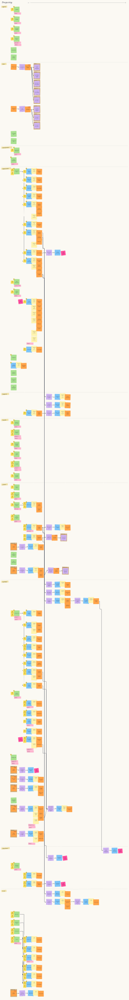

# Prospecting

This context holds the organizations an account prospects, their contacts, the exchanges with them, and the to-dos for them. Code: `packages/core/src/Prospecting`.

## The wall

Each lane alone: [Agenda](../event-storming/prospecting/agenda.svg), [Attachment](../event-storming/prospecting/attachment.svg), [Contact](../event-storming/prospecting/contact.svg), [Duplicate](../event-storming/prospecting/duplicate.svg), [Exchange](../event-storming/prospecting/exchange.svg), [Facts](../event-storming/prospecting/facts.svg), [Identification](../event-storming/prospecting/identification.svg), [Organization](../event-storming/prospecting/organization.svg), [Timeline](../event-storming/prospecting/timeline.svg), [To do](../event-storming/prospecting/to-do.svg). The wall is drawn from the code (`make event-storming`, `docs/architecture/event-storming.md`). Its interactive page is served under `/docs/event-storming/prospecting/`: https://prospecter.localhost/docs/event-storming/prospecting/ locally, the same path on dev.

## Language

- **Organization** (`Organization`): an organization an account prospects. The account's whole team shares it. It has:
  - its legal identity, with an optional SIRET, its establishment's number (ADR 0158);
  - its contact details, its links to outside tools and its optional website (the shared kernel's `ExternalReferences`, `Website`, ADR 0160, ADR 0165);
  - its address, its position and its municipality's INSEE code, as the geocoder found them (`Location`, ADR 0142);
  - its observations, its logo, its holding, and its contacts (`ContactId`s only, the identities of PersonalData's persons).
- **Possible duplicate**: an organization of the account that another one resembles. They resemble each other by name, ignoring the legal form, and by city (`ResemblanceKey`). They may be the same organization, entered twice. Prospecter flags both and never refuses them. The flag stays until a member checks and states that it is not a duplicate (ADR 0162).
- **Establishment** (`Establishment`): a company's establishment as the public company directory lists it. It has a SIRET, its company's name, an address, an activity (its NAF code), and whether it has closed. Prospecter proposes establishments so that a member records an organization's SIRET without typing it (ADR 0158).
- **Prospector** (`Prospector`): a member as Prospecting sees them. It says who acts, for which account, and whether they read the personal data an exchange may hold.
- **Exchange** (`Exchange`): a real-world fact with a contact or with the organization itself. It is a call, a message (SMS, email, LinkedIn, Malt), a meeting or a video call. Its facts are its channel, direction, moment, text, duration, and place or link (`ExchangeFacts`). It is kept for the organizations the contact was part of (ADR 0074, 0076). Its status (`ExchangeStatus`, ADR 0111, 0112) starts as planned, while it is still to come. It then becomes done, missed when the contact did not come or answer, or cancelled.
- **Planned exchange**: a call, a meeting or a video call agreed on for later. Its text is its agenda, and it lasts a `Duration`. Its author, the member who planned it, holds it. Only the holder can:
  - mark it done (its **report**) or missed, once its time has come;
  - move it, with a new duration if one is given;
  - cancel it (ADR 0112, 0119).

  While it is planned, it is in the holder's **agenda**. The agenda tells when a `Slot` overlaps it (ADR 0111).
- **My day**: the exchanges a member still has planned on the reader's day, shown on their dashboard (`ConsultMyDay`). Those whose time has come come first, to handle. The first five planned after that moment follow. A cancelled, done or missed exchange leaves the day's programme.
- **What is to process**: two lists on a member's dashboard:
  - the exchanges they planned whose end has passed and that they have not marked done, missed or cancelled (`ConsultWhatIsToProcess`). They come oldest first, whatever their day, and the member handles each one from there. An exchange still in progress is not to process yet;
  - the to-dos they still have to do, due on the reading day at any hour, or on earlier days. The most overdue comes first. Each shows the number of days since its day, read on the member's clock (ADR 0134).
- **Calendar**: a member reads it one period at a time, six weeks at most (`CalendarPeriod`, ADR 0115). It shows:
  - the exchanges the member holds, planned or logged by them, whatever their status, each at the moment it happens;
  - the to-dos they hold that are due on a day of the period, done or not. Each one shows on its day and at its written hour, never converted to an instant (ADR 0134).
- **Late**: Prospecter reads lateness at the moment of reading, on the member's clock. Late means:
  - a planned exchange whose slot has ended and that the holder has not marked done, missed or cancelled yet;
  - a to-do that is not done once its hour has passed, or its day when it has no hour.

  The `Lateness` rule decides it. It reads an exchange's `ExchangeStatus` and `Slot`, and a to-do's `Due` and whether it is done (`Due::hasPassedBy()`, ADR 0134). The read models express it in their own terms through `Overdue`.
- **Timeline**: the exchanges with a contact, or those of an organization and its contacts. What is to come after the moment of reading comes first, soonest first. The first of them is a contact's **next exchange**. The past follows, most recent first. A cancelled exchange is listed there from the moment of its cancellation (ADR 0111, 0112).
- **Venue**: where a meeting is held, its place, written freely. For a video call, it is the web address that joins the call (`VideoCallLink`). The **place proposed** to meet a contact is the address of their first organization that has one.
- **To-do** (`ToDo`): work a prospector prepares for a contact or an organization, without them present (send a CV, prepare a proposal). It is due on a day, and at an hour of that day when one is given (`Due`). The member who logged it holds it. The holder ticks it off once it is done (ADR 0113).
- **Campaign exchange**: an exchange logged for a recipient of a started campaign in Campaigns. It goes through the campaign's channel, outbound, and is done or missed. It keeps the campaign's identity. The timeline and the exchange's detail show the campaign's current name in Campaigns. They show none once the campaign is erased (ADR 0145). Once the exchange is erased, its last facts still name its contact and its campaign (ADR 0152).
- **Imported exchange** (`ImportedEmail`): an e-mail that a member's mailbox received from a contact or from an organization's own address. It can also be an e-mail the member sent to one of them. The import logs it as if the member did: an e-mail received or sent, and done. Its text is the subject followed by the e-mail's text. It keeps its source: the provider and the e-mail's identity (ADR 0154). It also keeps the id the provider gives the message in the importing mailbox (ADR 0174). An e-mail imported before ADR 0174 has no such id. Every reader of the account sees the source, in the timelines and in the detail. For a member who manages personal data, the detail opens the message in Gmail once its id is kept (the API's presenter, ADR 0174).
- **Contact to attach** (`ContactToAttach`): a contact of the account that no organization names yet. It is a person who took a meeting with a member before anyone knew whom they work for. That member is its **holder**. The holder keeps the contact with its exchanges and to-dos, kept for no organization. The contact stays so until a member attaches it to an organization. Otherwise, it is erased from the start of the 30th day after its last meeting, on that meeting's clock (ADR 0146).
- **To redact**: what an exchange may still hold of a forgotten contact. Its text stays to redact until a correction declares it redacted. Its files stay until a member removes them (ADR 0079).

## Rules

- An organization is named by its corporate name or by its email. Its email is unique among the account's organizations (`EmailUniqueness`, ADR 0039). A member finds it by the beginning of its name or its email (ADR 0071). Prospecter also recognizes it by its phone number (ADR 0072).
- SIRET:
  - A SIRET has fourteen digits, checked by Luhn. La Poste's SIRETs are checked by the sum of their digits (`Siret`).
  - A SIRET designates one organization of an account. Another account may prospect the same establishment (`SiretUniqueness`). `SiretAlreadyUsed` names the organization that has it.
  - The establishments proposed for an organization are those the directory names like it. Those of its municipality come first, then those anywhere, each once. An organization without a corporate name gets no proposal.
  - When the directory does not answer, the member types the SIRET by hand (`SearchEstablishments`, the `EstablishmentDirectory` port, ADR 0158).
- An organization's links and website:
  - Its links are the addresses of its pages on outside tools, five at most. Prospecter recognizes each one by its source and an identifier. It keeps the pasted address to open it. The sources are a company on LinkedIn (`linkedInCompany`) or on Welcome to the Jungle, and any other site under its host.
  - Prospecter refuses a known tool's page that designates a person, such as a LinkedIn or Malt profile. It also refuses a page on such a site that is none of its recognized pages, such as a school or a showcase page (`ReferenceOfAnotherKind`, `UnrecognizedPage`, `NotAWebAddress`, `TooManyLinks`).
  - Prospecter keeps the website as its origin. It adds `https` when the member typed no scheme. It recognizes the website by its domain: its host without `www.`. An address that is no site is refused (`InvalidWebsite`).
  - A member records links and a domain with the contact details, and when the organization starts being prospected.
  - Each link and domain designates one organization of an account. Another account may record them too. A dropped link is free for another organization (`ReferenceUniqueness`, `WebsiteUniqueness`). `ReferenceAlreadyUsed` and `WebsiteAlreadyUsed` name the organization that has them (ADR 0160, ADR 0165).
- Possible duplicates (ADR 0162):
  - The resemblance key is the corporate name, ignoring case, accents, punctuation and legal form, beside the city typed. An organization without a name or a city raises no suspicion.
  - When an organization is started, renamed or moved, Prospecter suspects it of being a duplicate of each organization of its account with the same resemblance key. It lifts the suspicion on those it no longer resembles (`DuplicateSuspicion`, the events `DuplicateSuspected` and `DuplicateSuspicionLifted`).
  - In return, a policy makes the other organization suspect the newcomer, or lift its suspicion of it (`SuspectDuplicateInReturn`, `LiftSuspicionInReturn`). A suspected or lifted organization keeps its modification moment. When the account stops prospecting an organization, its suspicions are lifted.
  - Every prospector of the account can check a suspicion and state that the organization is no duplicate of the other one (`DismissPossibleDuplicate`). A statement about an organization it is not suspected of is refused (`NotASuspectedDuplicate`). The two organizations are then never suspected of each other again (`DismissSuspicionInReturn`).
  - An organization's sheet and the list name its possible duplicates that are still prospected.
- A client can complete an organization with what it knows about it (`CompleteOrganization`, ADR 0177):
  - The empty fields get filled: the SIRET, links while there is room among the five, the website, the email and the phone number.
  - A recorded value is never replaced. Nothing changes when there is nothing to fill. Each value stays unique among the account's organizations.
  - Beforehand, `CompareWithOrganization` applies the same rule. It says which fields the completion would fill and which ones the client gives differently.
  - A collected contact joins its organizations. An organization that already names them is skipped, because a member attached them meanwhile (`AttachCollectedContact`).
- A client can identify organizations from the clues it gives about them (`IdentifyOrganizations`, ADR 0173). This only reads. It takes a whole list at once and keeps its order:
  - It looks by the organization's keys, the surest first: the SIRET, each link, the website's domain, and each email. Then it takes each email's domain as a website's domain, except a public mailbox (`OrganizationKeys`, `PublicMailDomains`).
  - When the keys designate one organization, the organization is **known**. When they designate several, they are **to confirm**, never known.
  - When the keys designate none, it looks by the name without the legal form (`CorporateNameKey`). It searches the account's first 50 organizations whose name begins the same way, those of the same city first. What it finds is to confirm.
  - Otherwise the organization is **new**.
  - A clue that is no key of its kind designates nothing. It does not refuse the list.
- A holding is an organization of the same account (`AttachToHolding`).
- Geocoding (ADR 0142):
  - When an organization moves, Prospecter geocodes it. It gets its position and its municipality. It gets none when the geocoder does not find its address.
  - An organization located before Prospecter kept municipalities gets its municipality once. Its address is geocoded again (`LocateAgain`). The event `LocatedAgain` is by the member who started prospecting it. The organization keeps its modification moment. Nothing happens for an organization that already has a municipality.
- A contact is a person the account prospects in PersonalData. A member adds it to an organization and removes it from one. When no organization names a contact any more, PersonalData erases it (`OrphanContacts`, ADR 0041, 0042). When the account stops prospecting an organization, the organization lets its contacts go.
- A contact to attach waits without an organization (ADR 0146):
  - Only its holder plans an exchange, logs an exchange or logs a to-do with it (`ContactToAttachOfAnother`). Each one is kept for no organization (`ContactOrganizations::keepersOf()`).
  - Members read its page and its timeline like any contact's.
  - Each meeting later than its last one pushes its erasure back (`PushBackErasureOfContactToAttach`).
  - Once a member adds it to an organization (`AddContact`), its exchanges and to-dos are kept for that organization (`KeepExchangesOfAttachedContact`, `KeepToDosOfAttachedContact`). It is no longer to attach (`AttachContactToAttach`).
  - Prospecter proposes to attach it to the account's organization whose email has the contact's email domain. It proposes none for a public mailbox (`ProposeOrganizationToAttach`, `PublicMailDomains`). It reads the contact's e-mail from PersonalData, in clear, through the port `ContactEmailRetriever`, and keeps none (ADR 0217).
  - A person can book a slot through a member's public link. That member then meets them (`PlanBookedAppointment`, ADR 0164):
    - the person becomes a contact to attach when nobody holds them yet and no organization names them;
    - a contact to attach that another member holds passes to this member (`ContactToAttach::handOverTo()`, `ContactToAttachHandedOver`). The new meeting pushes their erasure back if it is later. What the former holder logged with them stays the former holder's;
    - the member plans and holds the booked exchange, under the appointment's identity. Its text is the subject. For a video call, the exchange requests its link from the member's calendar. The exchange is booked by its contact (`Exchange::bookedByAContact()`). Its timeline, its calendar and its detail say so.
  - The platform's daily schedule erases a contact that is never attached (`EraseContactLeftUnattached`, ADR 0147, 0161). It does so within the 24 hours after the start of the contact's 30th day. Its holder forgets its person in PersonalData. Its exchanges are erased (`EraseExchangesOfContactLeftUnattached`). Its to-dos go with its person.
- A rule says what an organization's state offers (`OrganizationPossibilities`, ADR 0088): a logo to remove, a holding to detach from, and a contact to remove.
- Exchanges and their status (ADR 0111):
  - A member logs an exchange once it has happened, never in the future. It is done or missed.
  - A planned exchange is a call, a meeting or a video call in the future. It lasts 5 minutes to 8 hours, and half an hour when no duration is given.
  - An exchange read without a status is done. An exchange read as done, with the facts of a call that did not go through, is missed.
  - Nobody corrects a planned or cancelled exchange as a whole.
- Only a call, a meeting or a video call is planned (`ChannelNotPlanned`) or missed (`ChannelNotMissed`). A message (an SMS, an email, a LinkedIn or a Malt message) is received or sent.
  - Only its holder can handle a planned exchange (`NotTheHolder`):
    - the holder marks it done or missed once its time has come (`NotYetDue`), never in the future. Its report replaces its agenda;
    - the holder moves it to a moment to come. It keeps its own duration unless a new one is given (ADR 0119);
    - the holder cancels it, and may say who called it off (`Canceller`);
    - once it is done, missed or cancelled, it no longer changes (`NotUpcoming`).
  - What an exchange offers depends on its reader and on the moment of reading (`ExchangeSituation`).
  - When its contact is forgotten, an exchange still to come is cancelled (ADR 0112).
- Venues:
  - Only a meeting can have a place. Only a video call can have a link, which must be a web address (`ExchangeFacts`).
  - A member may plan a video call without its link and give it later. The video call may instead request a link from its holder's calendar (`linkRequested`). Another channel cannot request one (`LinkOnlyForAVideoCall`).
  - The system keeps the link created as a correction by nobody, without an author. Connectors' `VideoCallLinkCreated` sends `KeepCreatedVideoCallLink` (`Exchange::receiveLink()`, the event `VideoCallLinkReceived`, by its holder, ADR 0137).
  - A link given or received ends the request. A link given meanwhile wins. A removed link does not come back.
  - Every prospector of the account corrects a meeting's place or a video call's link, planned or done (`CorrectExchangeVenue`, the intent `CorrectVenue`). Neither is personal data. Neither is to redact once the contact is forgotten (ADR 0114).
  - An exchange corrected as a whole keeps its venue while its channel has one.
- Access to exchanges:
  - Every prospector of the account reads the exchanges. Without the right to manage personal data, a prospector gets the text flagged and the attachments hidden. Their download is refused. Every prospector can correct the text (ADR 0078).
  - Every prospector plans an exchange and handles the ones they hold. Logging an exchange that took place needs the right (ADR 0129).
- A prospector logs the exchange of a recipient of a started campaign (`NoteCampaignExchange`). Prospecting asks Campaigns whether the contact is a recipient still to handle, and asks for the campaign's channel (`CampaignRecipients`, `RecipientInCampaign`). It refuses:
  - an unknown campaign, including one of another account (`UnknownCampaign`);
  - a campaign not started (`CampaignNotRunning`);
  - a contact who is not a recipient (`UnknownRecipient`);
  - a recipient already handled (`RecipientAlreadyProcessed`).

  Otherwise, Prospecting logs the exchange like any other, never in the future. Its facts name its campaign and its contact. Campaigns processes the recipient from them (ADR 0145). Prospecting fingerprints it like any logged exchange, from where it was sent.

  When an AI logs it (`noteOnce`), Prospecting recognizes a sending logged before. It does so before it asks about the recipient (ADR 0186). The import of Gmail may have logged the e-mail the AI sent first, outside any campaign. When that exchange has the same contact and goes outbound on the campaign's channel, it joins the campaign instead (`Exchange::joinCampaign()`, `ExchangeJoinedCampaign`, ADR 0195). The join is a correction by the AI's member. The recipient is still to handle. The exchange's facts then name the campaign. Prospecting refuses any other sending logged before as « already logged », not as already handled.

  The query `SendingNoted` tells which exchange the sending was logged as. It reads what the AI gave and fingerprints it as the command does (`RecipientInCampaign::fingerprintOfSending()`).
- Connectors can report an e-mail exchanged (`EmailExchanged`). Prospecting then logs it as an exchange by the member whose mailbox imported it (`NoteImportedEmail`, `Exchange::noted()` with `Noting::imported()`). It keeps it like an exchange logged by hand: for the contact's organizations, or for the organization itself.
  - Its identity derives from the account, the e-mail, and its contact or organization (`ExchangeId::ofImportedEmail()`). So each e-mail is imported once per correspondent, by the first member whose mailbox imported it.
  - An e-mail is never imported again once its exchange is erased. It is not imported when an AI or a member logged it before (its fingerprint, below).
  - Nothing is imported with a contact forgotten meanwhile, or with an organization no longer prospected. Nothing is imported with a contact that another member holds to attach.
  - Its facts are those of any exchange. Reporting counts it as a logged e-mail (ADR 0154).
  - Connectors sends the e-mail's files to the storage. Prospecting attaches them to the exchange as if its member did (`Exchange::importAttachment()`). Their identity derives from the exchange and the upload (`AttachmentId::ofImportedEmail()`).
  - Each upload is kept once the exchange is written (`KeepImportedAttachment`, which its policy sends for `AttachmentImported`). An upload already kept leaves nothing to do.
  - Its text ends with a line for each file the exchange does not hold (`AttachmentLeftOut`, ADR 0182). A file can be left out by the import, when it is over 10 MB or beyond the tenth. It can also be gone from the storage, or beyond what an exchange holds. The line reads « Pièce jointe non importée : video.mp4 (25 Mo), à ouvrir dans Gmail ».
  - The size is rounded in megabytes from one megabyte up, and in kilobytes below it. Below a kilobyte, it reads « moins de 1 Ko ».
- Fingerprints (ADR 0166):
  - The core fingerprints an exchange logged with a contact, an organization or a campaign recipient. It also fingerprints an imported exchange (`ExchangeFingerprint`). A client never does.
  - The core fingerprints the exchange from where it was read (`MessageReference`, not kept):
    - an e-mail by its `Message-ID`'s identity (Prospecting's `MessageId`, computed by the same rule as Connectors' one, ADR 0197) and its correspondent;
    - a LinkedIn message by its conversation (its identifier, or its thread's address), its direction, its minute and its text. The text ignores case, punctuation and extra spaces;
    - any other exchange, and one given without a reference, by its channel, correspondent, direction, minute and text. The text is normalized the same way;
    - a reference of another channel is refused (`ReferenceNotOfTheChannel`).
  - Each fingerprint is registered once in the account. It is kept once its exchange is erased, with who erased it (`NotedOnce`, `ExchangeRepository::fingerprinted()`).
  - When an AI logs an exchange (`noteOnce`), an exchange logged before is refused:
    - `ExchangeAlreadyNoted` names the exchange logged first;
    - `ExchangeErasedBefore` says who erased it and when;
    - `ExchangeNotedMeanwhile` is raised when two loggings race.

    The import then logs nothing. A campaign's sending logged first outside any campaign joins the campaign instead (above, ADR 0195).
  - A member who logs an exchange by hand is never refused. The exchange registers its fingerprint when there is none yet.
  - Forgetting a contact forgets their exchanges' fingerprints, erased or kept (`ForgetFingerprintsOfForgottenContact`).
- Origin (ADR 0185):
  - An organization and an exchange keep their origin (the shared kernel's `Origin`). It is by hand, or by an AI that acts as the member through the MCP server. The AI is never named.
  - The command that creates them gives it (`byAnAI` of `StartProspecting`, `NoteExchange`, `NoteOrganizationExchange`, `NoteCampaignExchange`, `PlanExchange`, `PlanOrganizationExchange`). Only the MCP server's tools set it.
  - Nothing changes it afterwards: neither a correction by hand nor a completion by an AI.
  - The sheet, the timelines and an exchange's detail say it (`createdByAnAI`). An imported exchange keeps its own mark (`importedFrom`).
- An exchange holds 10 files at most, of 10 MB each at most (`ExchangePossibilities`, ADR 0077). An erased exchange takes its files with it.
- An exchange is kept for the organizations its contact was part of when it was logged. It is erased with the last of them (ADR 0074). `StopKeepingExchanges` saves the exchanges still kept. `EraseExchangeLeftWithoutOrganization` erases each of the others in its own command, which its policy sends for each `ExchangeLeftWithoutOrganization`. Nothing is left to do for an exchange already gone.
- A forgotten contact's exchanges stay in their organizations' timelines, to redact. A timeline counts the exchanges to redact (`ExchangeConformity`, ADR 0079).
- To-dos (ADR 0113):
  - A to-do has a text. Like an exchange, it is kept for the organizations its contact is part of when it is logged, or for the organization itself. It goes with the last of them (`StopKeepingToDos`, then `EraseToDoLeftWithoutOrganization`).
  - A forgotten contact's to-dos are erased (`EraseToDosOfForgottenContact`).
  - A done to-do is not ticked off again. Only a done to-do is unticked (`ToDoPossibilities`).
  - Members read its lists whole: a contact's, an organization's (its own and its contacts'), and a member's (those still to do). The to-dos to do come first, soonest due first. On a day, a to-do without an hour comes before those with an hour. The done to-dos follow, last done first.
- In an organization's timeline, an exchange's contact is present, removed from it, or forgotten (`ContactPresence`, ADR 0076, 0079).

## What it publishes

- The service `WhichAreProspectedService` says which organizations an account prospects. PersonalData asks it when a contact is collected (ADR 0089).
- The service `IdentifyOrganizationsService` says which of an account's organizations some clues designate, as `IdentifyOrganizations` does: its handler answers both. PersonalData asks it to identify persons among the organizations they work for (ADR 0173, 0217).
- The service `WhichOrganizationsHaveTheseEmailsService` says which of an account's organizations have given addresses, whatever their case, by their email reservation. Connectors asks it to recognize whom an e-mail was exchanged with (ADR 0154).
- The service `WhichEmailsHaveTheseOrganizationsService` gives the address of each organization an account prospects. An organization without an address has none. An organization the account does not prospect is absent. Connectors asks it to reimport the e-mails a mailbox exchanged with an organization itself.
- The service `WhichContactsHaveExchangesOfCampaignService` says which of given contacts have an exchange of a campaign that the account keeps. Campaigns asks it for its pending recipients. So the next recipient does not wait for the reaction that processes them (ADR 0195).
- The service `NameOrganizationsOfContactsService` gives, for each contact, the full names of the account's organizations that name them. They come in the order of their identities, the first one first. A contact that no organization names is absent. Campaigns asks it to render `{organization}` in a campaign's message (ADR 0144).
- The service `ConsultHeldExchangesService` gives an account's exchanges as their holders hold them. Connectors asks it at each fact of an exchange, to push the exchange (ADR 0127). For each exchange, it gives:
  - its holder, status, channel, moment, duration, and place or link;
  - whether a video call requests its link (ADR 0137);
  - its contact, and the first organization it is still kept for, with its name. A contact to attach has no organization;
  - whether the contact booked it through its holder's public link (ADR 0175).

  An erased exchange is absent. An exchange no longer kept for any organization is absent too, except the exchange of a contact to attach.
- The integration events `ContactsLeftWithoutOrganization` (ADR 0046) and `ContactLeftUnattached` (ADR 0146).
- The facts of its organizations and its exchanges, so that a context can count them without reading its tables (ADR 0099):
  - An organization's facts: present, located, the contacts it names (ADR 0141), its municipality's code and its address's country (ADR 0142).
  - An exchange's facts: present, its status, the moment it happens, its contact and its campaign (ADR 0145).
  - Prospecting publishes them each time one changes (`OrganizationFactsChanged`, `ExchangeFactsChanged`). It also publishes them by slice for an account (`ListOrganizationFactsService`, `ListExchangeFactsService`).
  - An organization the account stops prospecting gives a last fact: absent. So does an erased exchange.
  - An exchange that no organization keeps any more is erased like one a member erases. Its last fact says it went with its organization (ADR 0155).

## Features

`commencer-a-prospecter`, `consulter-une-organisation`, `rechercher-mes-organisations`, `reviser-l-identite` (its SIRET too), `soupconner-un-doublon`, `dire-que-ce-n-est-pas-un-doublon`, `rechercher-un-etablissement`, `identifier-des-organisations`, `completer-une-organisation`, `changer-les-coordonnees` (its links and its website too), `demenager`, `ecrire-des-observations`, `changer-le-logo`, `retirer-le-logo`, `rattacher-a-une-holding`, `rattacher-un-contact`, `retirer-un-contact`, `arreter-de-prospecter`, `noter-un-echange`, `l-empreinte-d-un-echange`, `reconnaitre-ce-qu-une-ia-a-cree` (with PersonalData), `mener-une-campagne` (with Campaigns), `planifier-un-echange`, `traiter-un-echange-planifie`, `consulter-un-echange`, `corriger-un-echange`, `corriger-le-texte-d-un-echange`, `corriger-le-lieu-ou-le-lien-d-un-echange`, `supprimer-un-echange`, `joindre-des-fichiers-a-un-echange`, `retirer-une-piece-jointe`, `telecharger-une-piece-jointe`, `consulter-la-timeline-d-une-organisation`, `les-echanges-d-un-contact-retire-ou-efface`, `consulter-mon-calendrier`, `consulter-ma-journee`, `consulter-ce-que-j-ai-a-traiter`, `importer-un-e-mail-recu`, `importer-un-e-mail-envoye` and `importer-les-pieces-jointes-d-un-e-mail` (with Connectors), `reconnaitre-un-echange-importe` (with Connectors), `noter-une-action-a-faire`, `modifier-une-action-a-faire`, `cocher-une-action-a-faire`, `supprimer-une-action-a-faire`, `les-actions-a-faire-d-une-organisation-ou-d-un-contact-efface`, `les-contacts-a-rattacher`, `proposer-une-organisation-a-rattacher`, `effacer-les-contacts-jamais-rattaches`, `publier-les-faits-de-prospecting`, and the `langage-publie` questions.

## In the code

`src/Prospecting/{Domain,Application}`:

- `src/Prospecting/Application`, in ten modules (ADR 0206). The sections below describe their use cases:
  - `Organization`, an organization the account prospects, its identity and its card: `StartProspecting`, `StopProspecting`, `ConsultOrganization`, `SearchProspectedOrganizations`, `SearchEstablishments`, `ReviseLegalIdentity`, `CompleteOrganization`, `CompareWithOrganization`, `ChangeContactDetails`, `Relocate`, `LocateAgain`, `WriteObservations`, `ChangeLogo`, `RemoveLogo`, `DiscardRemovedLogo`, `AttachToHolding`, `DetachFromHolding`, and the services it publishes, `WhichAreProspected`, `WhichOrganizationsHaveTheseEmails` and `WhichEmailsHaveTheseOrganizations`;
  - `Duplicate`, an organization's possible duplicates (ADR 0162): `DismissPossibleDuplicate`, `SuspectDuplicateInReturn`, `LiftSuspicionInReturn`, `DismissSuspicionInReturn`;
  - `Identification`, which organization a clue designates: `IdentifyOrganizations`, `RecognizeCallingOrganization`;
  - `Contact`, an organization's contacts and the contacts to attach (ADR 0146): `AddContact`, `RemoveContact`, `AttachCollectedContact`, `DetachForgottenContact`, `AttachContactToAttach`, `ConsultContactToAttach`, `ProposeOrganizationToAttach`, `PushBackErasureOfContactToAttach`, `EraseContactLeftUnattached`, the translators `PublishContactLeftUnattached` and `PublishContactsLeftWithoutOrganization`, the queries `ConsultOrganizationsOfContacts` (batch) and `ListOrganizationContacts`, and the services it publishes, `NameOrganizationsOfContacts` and `WhichOrganizationsNameTheseContacts`;
  - `Exchange`, an exchange logged, planned, handled, read alone, corrected, kept and erased: `NoteExchange`, `NoteOrganizationExchange`, `NoteCampaignExchange`, `NoteImportedEmail`, `SendingNoted`, `PlanExchange`, `PlanOrganizationExchange`, `PlanBookedAppointment`, `KeepCreatedVideoCallLink`, `MarkExchangeDone`, `MarkExchangeMissed`, `MoveExchange`, `CancelExchange`, `ConsultExchange`, `CorrectExchange`, `CorrectExchangeText`, `CorrectExchangeVenue`, `ProposeMeetingPlace`, `EraseExchange`, `EraseExchangeLeftWithoutOrganization`, `StopKeepingExchanges`, `KeepExchangesOfAttachedContact`, `KeepExchangesOfForgottenContact`, `EraseExchangesOfContactLeftUnattached`, `ForgetFingerprintsOfForgottenContact`, and the service it publishes, `WhichContactsHaveExchangesOfCampaign`;
  - `Timeline`, a contact's or an organization's exchanges, read in time: `ConsultTimeline`, `ConsultOrganizationTimeline`, `ConsultUpcomingExchanges`, `ConsultOrganizationUpcomingExchanges`, `ConsultTimelineIntents`, `ConsultExchangesToMakeConform`. `Timeline`, which its queries share with the port `TimelineRetriever`, its output port `TimelineOutput` and the presenter `KeptTimeline`, and `CampaignsOfTimeline` sit at its root;
  - `Agenda`, the exchanges a prospector holds: `ConsultCalendar`, `ConsultMyDay`, `ConsultWhatIsToProcess`, `ConsultOverlappingExchanges`, and the services it publishes, `ConsultHeldExchanges` and `ConsultPlannedExchanges` (ADR 0133). `HolderIntents`, `Overdue` and `PublishedHeldExchanges` sit at its root;
  - `Attachment`, an exchange's files: `AttachFile`, `RemoveAttachment`, `DownloadAttachment`, `KeepImportedAttachment`, `DiscardAttachmentsOfErasedExchange`, `DiscardRemovedAttachment`;
  - `ToDo`, the to-dos: `NoteToDo`, `NoteOrganizationToDo`, `ReviseToDo`, `TickOffToDo`, `UntickToDo`, `EraseToDo`, `ConsultToDo`, `ConsultToDos`, `ConsultOrganizationToDos`, `ConsultMyToDos`, `StopKeepingToDos`, `EraseToDoLeftWithoutOrganization`, `EraseToDosOfForgottenContact`, `KeepToDosOfAttachedContact`. The output port its lists share, `ToDoListOutput`, and its presenter `KeptToDoList` sit at its root;
  - `Facts`, the facts published to the other contexts (ADR 0099): `ListExchangeFacts`, `ListOrganizationFacts`, `PublishExchangeFacts`, `PublishOrganizationFacts`;
  - at the application's root, what several modules read: `OrganizationSheet` and its `PossibleDuplicate`, `ExchangeInTimeline`, `ToDoList` and its `ToDoInList`, `ContactToAttachInList`. The policies are in `Policy/` and the ports in `Port/`.
- The reactions are policies, in `Application/Policy`: each one turns an event into the command named below, `<Intent>Policy` for the command `<Intent>` (ADR 0203).
- Organizations and contacts:
  - the organizations an account prospects (`Organization`), and `StopProspecting`;
  - its contacts (`ContactId`s only, `AddContact` / `RemoveContact`). A contact is never left alone: `OrphanContacts`;
  - the `Prospector` who acts or reads, with or without the right to manage personal data. Its `Gesture` starts prospecting an organization (`Organization::prospectedBy()`). The `Prospectors` port reads it (`prospectorFrom()`), implemented outside the core from Accounts' members;
  - the `KnownContacts` port says whether a person is one the account prospects, or which of several persons are. PersonalData answers it;
  - an organization's possible duplicates (ADR 0162):
    - `ResemblanceKey`, and `DuplicateSuspicion` before the organization is saved;
    - `Organization::reconsiderDuplicates()`, `suspectDuplicateOf()`, `liftSuspicionOf()`, `dismissSuspicionOf()`, `knowItIsNoDuplicateOf()`;
    - `DismissPossibleDuplicate`, and the commands in return `SuspectDuplicateInReturn`, `LiftSuspicionInReturn`, `DismissSuspicionInReturn`, which their policies send (ADR 0203);
    - read as `PossibleDuplicate`;
  - `ListOrganizationContacts` reads an organization's contacts, by their ids, in the order they were attached. A contact PersonalData no longer knows is left out, asked through `KnownContacts` (ADR 0217);
  - `ConsultOrganizationsOfContacts` (batch), `RecognizeCallingOrganization` (which organization has a number), and `IdentifyOrganizations` (which organizations clues designate, read through the `DesignatedOrganizationRetriever` port, ADR 0173).
- Logging and planning exchanges:
  - the exchanges with a contact or with the organization itself (`Exchange`: a real-world fact, its `ExchangeFacts`, ADR 0074, 0076);
  - `Exchange::noted()`, `planned()` and `bookedByAContact()` create them (ADR 0191). They take the member's `Gesture` and the `Correspondent`. The correspondent is a `ContactCorrespondent` with the organizations that keep the exchange, a campaign's `RecipientCorrespondent`, or an `OrganizationCorrespondent`. Once the exchange took place, they also take the `Noting`: its facts and outcome, and where the message or the imported e-mail was read;
  - `NoteExchange` keeps the exchange for the organizations the contact is part of at that time (`ContactOrganizations`). `NoteOrganizationExchange` logs it from an organization's card, with the organization or one of its contacts;
  - `NoteCampaignExchange` logs it for a campaign recipient (`RecipientCorrespondent`, `RecipientInCampaign`, the `CampaignRecipients` and `CampaignNames` ports). `CampaignsOfTimeline` names a timeline's campaigns (ADR 0145);
  - `PlanExchange` and `PlanOrganizationExchange` work likewise, for a planned exchange (`Exchange::planned()`, `ExchangeFacts::planned()` with its `withVenue()` and `askingALink()`, `Duration`, ADR 0111);
  - its holder runs `MarkExchangeDone`, `MarkExchangeMissed`, `MoveExchange` and `CancelExchange` (`Exchange::markDone()`, `markMissed()`, `moveTo()`, `cancel()`, its `Cancellation`). A cancelled exchange is listed from its cancellation (`ExchangeChronology`, ADR 0112).
- Reading exchanges. A view of Prospecting answers with the ids of the contacts it shows and of the members who hold or wrote what it shows. The API names them through Accounts and PersonalData, next to the view (ADR 0217):
  - `ConsultTimeline` reads up to the moment of reading, most recent first. `TimelineIntent` says what it offers. `ConsultOrganizationTimeline` reads an organization's exchanges and its contacts' (`OrganizationTimeline`). `ConsultOrganizationUpcomingExchanges` and `ConsultExchangesToMakeConform` read the same way;
  - `ConsultUpcomingExchanges` and `ConsultOrganizationUpcomingExchanges` read after that moment, soonest first;
  - `ConsultOverlappingExchanges` reads the exchanges in a prospector's agenda that a `Slot` overlaps, through the `AgendaRetriever` port;
  - `ConsultCalendar` (ADR 0115, 0119, 0134):
    - the exchanges a prospector holds in a `CalendarPeriod`, whatever their status, read through the `CalendarRetriever` port;
    - the ones they may move at the moment of reading;
    - their to-dos due on a day of the period, read through `ToDoListRetriever::dueIn()`;
    - what is late: `Lateness`, through `Overdue`;
  - `ConsultMyDay` reads, through the `AgendaRetriever` port, the exchanges a prospector still has planned on a day. It gives those to mark done or missed at the moment of reading, then the first five after it. `HolderIntents` says what an exchange offers its holder, for the calendar, the day and those to process;
  - `ConsultWhatIsToProcess`:
    - the exchanges a prospector planned whose `Slot` has ended at the moment of reading and that are still planned. They are late, as `Lateness` says. They come oldest first, with what each offers, read through the `AgendaRetriever` port;
    - their to-dos still to do on the reading day and before (`Due::daysOverdueAt()`, ADR 0134);
    - the contacts to attach they hold, the first to be erased first, read through the `ContactsToAttachRetriever` port (ADR 0146);
  - each agenda reading gives its interlocutors as Prospecting knows them (`AgendaInterlocutors`, `Interlocutors`): its organizations met with no contact, read alone, and its contacts' organizations. An organization no longer known leaves out its exchanges, which a reaction erases later. The contacts to attach leave out a contact PersonalData no longer knows, asked through `KnownContacts`;
  - `ConsultContactToAttach` says until when a person waits for the prospector to attach them;
  - `ConsultTimelineIntents` says what a person's timeline offers without reading it. It offers nothing for a person who is not a contact. A contact's card links to it;
  - `ConsultExchange` reads the whole exchange, who logged it and who corrected it last. `ExchangeIntent` says what its state offers its reader at the moment of reading. Just after a move, it is read from the moment it was moved from. It then offers to move it back there while that moment is to come (`MoveExchangeBack`, ADR 0135). Every prospector of the account reads it. Without the right, the text is flagged and the attachments hidden (`textFlagged`, `hiddenAttachments`, ADR 0078). It gives the organization itself when the exchange has no contact, while the organization is still known (ADR 0217).
- Correcting and erasing exchanges:
  - `CorrectExchangeText` corrects its text only, by every prospector of the account;
  - `CorrectExchangeVenue` corrects a meeting's place or a video call's link (`VideoCallLink`), by every prospector of the account;
  - `ProposeMeetingPlace` proposes the address of a contact's first organization that has one;
  - `CorrectExchange` corrects all its facts at once. Its contact stays. The last `Correction` is kept, and earlier versions are kept nowhere (ADR 0096);
  - `EraseExchange` erases one. Exchanges are erased with their last organization: `StopKeepingExchanges`, then `ExchangeLeftWithoutOrganization` and the command `EraseExchangeLeftWithoutOrganization` its policy sends, one per exchange.
- Attachments:
  - the files attached to an exchange (`Attachment`: 10 MB each, 10 per exchange at most, ADR 0077);
  - `AttachFile` takes an upload that the client sent to the storage. It measures it, then keeps it through the `PrivateStorage` port;
  - `RemoveAttachment`, and `DownloadAttachment`: a link signed for a moment, with the right to manage personal data;
  - an imported e-mail's files, attached by `NoteImportedEmail` and kept by `KeepImportedAttachment` (ADR 0182);
  - an erased exchange takes its files with it. A removed attachment or logo takes its file. A command, which a policy sends, removes each file from the storage once the removal is written (`DiscardAttachmentsOfErasedExchange`, `DiscardRemovedAttachment`, `DiscardRemovedLogo`, ADR 0101).
- A forgotten contact's exchanges stay, to redact. `ContactForgotten` sends `KeepExchangesOfForgottenContact` (`Exchange::forgetItsContact()`, ADR 0079). It cancels an exchange still to come (ADR 0112):
  - their text stays until a correction declares it redacted (`madeConform` of `CorrectExchangeText` and `CorrectExchange`, the intent `MakeConform`). Their files stay until a member removes them;
  - in an organization's timeline, an exchange's contact is present, removed from it or forgotten (`ContactPresence`). The timeline counts those to redact. `ConsultExchangesToMakeConform` lists them alone.
- To-dos (`ToDo`, `Due`, ADR 0113). `ToDo::noted()` creates one from the member's `Gesture`, a contact or organization correspondent, and a `Task` (its text and when it is due):
  - `NoteToDo` for a contact, kept for its organizations, and `NoteOrganizationToDo` for the organization itself. Then `ReviseToDo`, `TickOffToDo`, `UntickToDo` and `EraseToDo`;
  - `ConsultToDo`, `ConsultToDos` (a contact), `ConsultOrganizationToDos` (an organization and its contacts) and `ConsultMyToDos` (those a member still has to do). `ToDoList` orders them, read through the `ToDoListRetriever` port;
  - they are erased with their last organization (`StopKeepingToDos`, `ToDoLeftWithoutOrganization`, `EraseToDoLeftWithoutOrganization`). They are also erased with their contact (`ContactForgotten` sends `EraseToDosOfForgottenContact`).
